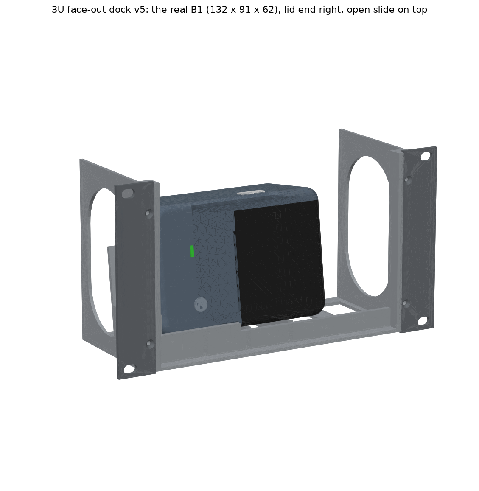

# NIIMBOT B1 Face-Out Dock — 10-inch 3U Rack Unit (v5, 27 Oct 2026)

The B1 stands on its long side with its **top facing out of the rack**. The label slot, power button, status light and lid all face you, so you can print labels without taking the printer out. It goes in the middle 3U of the T0-look rack.

## New in v5: built around the real B1 (your photos + the official manual)
- **Real size: 132 × 91 × 62 mm** (NIIMBOT manual; another edition says 61.6). The v4 cradle was sized for a 67 mm listing and took a 62 mm printer with spacers. The cradle is now sized for 62 mm + 1.5 mm. **No spacers, and no need to measure.**
- **Orientation from the photos:**
  - Stand the B1 face out with its **open slide (the white lid release on its side) on top**, where your finger can reach it (24 mm of room above).
  - The **lid end is then on your right.** The label slot, green light and power button all face you, in the open window.
- **The lid opens in the rack.** Where the B1's lid hinges isn't known: it's read from photos. `b1_dock.py` now hinges it along the top/rear edge opposite the label exit (changed on 28 Oct by another tool); the dock check gives **120°** of swing with that hinge and **85°** with the earlier guess (the back edge of the lid end). Either is enough to change the label roll without taking the printer out, so the dock print doesn't depend on it (`VERIFICATION_dock.txt`, 22 PASS both ways; checked 28 Oct, ultrareview). Look at the real printer before relying on it. The printer can also be lifted out by tipping it forward 3.5 mm.
- **Lip:** 5 mm, under the left (non-lid) half only. It clears the printer's 5 mm rounded edge, and the lid swings out over the low bottom bar.
- **USB-C port:** its position isn't visible in your photos. The bottom end (your left) is open above an 18 mm guide, and the back rest has a 50 mm cable notch, so a cable reaches either place.
- **Unchanged from v4:**
  - it leans back 8°
  - you remove it while racked by tipping it forward, lifting 3.5 mm and sliding it out
  - the open top and back, and the side-wall windows

**Size:** 254 × 132.55 mm panel (3U), 95 mm deep. The v4 files are in `_old_v4_2026-10-27/`.

## Print list
PLA (or PETG), 0.2 mm layers, 3 walls, 15% infill, **no supports**. On a P1S see `../PRINT_PLAN_P1S.md` (plates 4 and 8).

| File (`STL_for_printing/`) | Qty | On the bed (mm) | ≈ g each |
|---|---|---|---|
| `B1_Dock_3U_Body.stl` | 1 | 214 × 95 footprint, 130 tall, floor down | 120 |
| `B1_Dock_3U_Ear_x2.stl` | **4** (2 for the dock, 2 for the screen module) | 28 × 133 × 3, flat; turn one 180° | 10 |

The dock body is 214 mm wide, so it needs a full 220 mm bed. Turn the skirt off or keep it close.

## Hardware
| Item | Qty |
|---|---|
| M3 heat-set inserts (Ø4 hole, 6 deep), in the front posts | 4 |
| M3 × 8 countersunk, ears to body | 4 |
| M5 × 12 button head + washers (or M5 thumbscrews for tool-less removal) | 4 |
| Self-adhesive felt sheet (optional) | 1 |

## Assembly
1. Melt in the 4 inserts.
2. Screw on the ears.
4. Rack the dock.
5. Set the B1 in face out, **open slide on top** (lid end on your right), push it against the guide on the left with its bottom edge behind the lip, then let it lean back. A strip of the felt sheet on the ribs keeps it from sliding.
6. Run the USB-C cable out the back to a Pi USB port.

## Check by hand
- **Lid hinge:** the model assumes it's at the back edge of the lid end, from your photos. Open the lid once with the B1 in the dock, and check it swings out to your right without touching anything.
- **USB-C:** find the port on your B1. If it's on the bottom end it's free; if it's on the back, the cable goes through the back-rest notch.
- **Open slide:** keep it on top. Stood the other way up, the lid end would be on the left, where the guide blocks it.

`VERIFICATION_dock.txt` has **22 PASS, 0 FAIL** for the real B1, including the lid swing, the open-slide finger room and the face features in the window. The rack check with it is 38 PASS. `source/` regenerates every file: run `export_dock.py <out folder>` and `verify_dock.py`.
