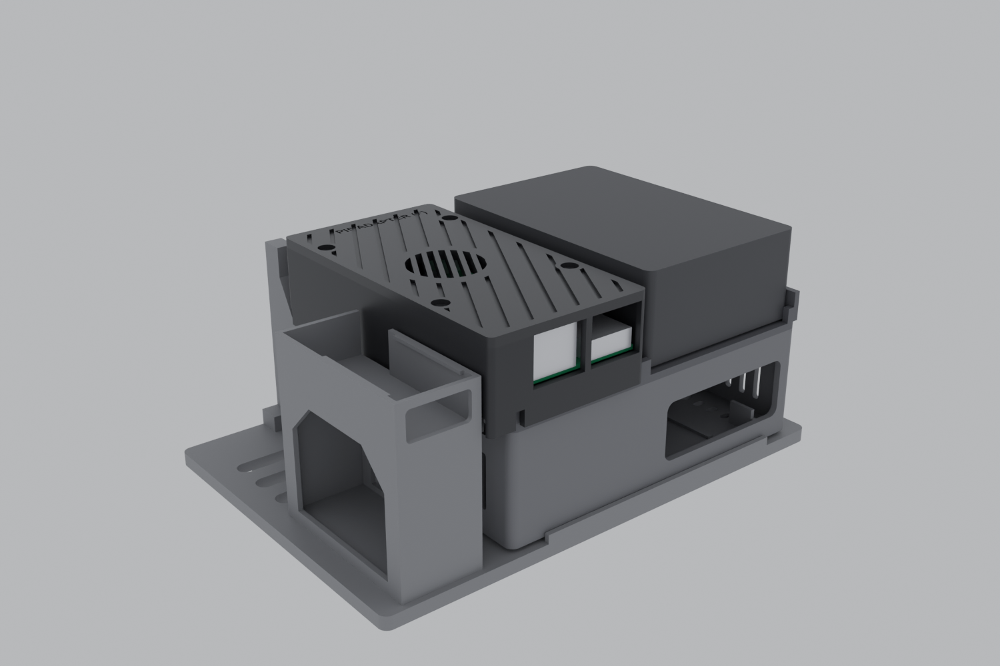
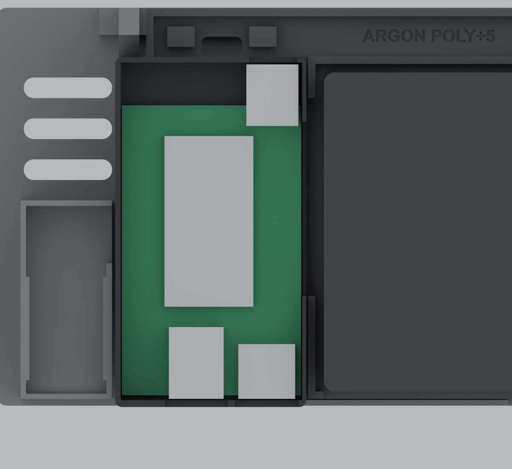

# Waveshare adapter (F) holder: sits beside the Argon Poly+ 5 (27 Oct 2026)

A black PETG box with a grooved lid and a round louvred vent window, styled after the Poly+ 5. It holds the **Waveshare Pi5 Connector Adapter (F)** on the free left part of the Argon tray (plate 11B), next to the case. Nothing else in `PRINT_THIS` changes: plate 10, the Poly+ 5 tray, the faceplate and the shelf are as they were.

| | |
|---|---|
| Parts | `Waveshare_F_holder_base.stl` + `Waveshare_F_holder_lid.stl`, 1 each |
| Size | 56 × 102.6 mm in plan, 28.8 mm tall once seated (top at z 65.7; the B1 dock's underside is at 81.3) |
| Print | PETG, 0.20 mm, 3 walls, 20% gyroid, **no supports**, ≈ 19 g + 12 g. See `SETTINGS.txt` |
| Checks | `../checks/VERIFICATION_waveshare_f_holder.txt`: 25 PASS, 0 FAIL |
| Source | `../source/waveshare_f_holder.py` (CadQuery), `../source/verify_waveshare_f_holder.py` |
| STEP | `../STEP_for_Onshape/Waveshare_F_holder_*.step`, in the v3 assembly frame |

## Read this first: what works and what doesn't

**1. NVMe and 2.5G Ethernet: yes, over the FFC.** The adapter reaches the Pi through its 16-pin FFC cable (100 mm in the box), which carries the Pi 5's PCIe lane to the M.2 slot and the RTL8125 2.5G chip. The board stays accessible: lid off, the M.2 slot, the FFC socket and the terminal are all on top. **Not verified:** how the FFC gets out of a Poly+ 5. Argon publish no drawing of the case's side wall. When the case arrives, check that the Pi's PCIe socket is reachable and the FFC can leave the case.

**2. HDMI 0 and the Type-C / plug connections to the Pi: no, not as Waveshare designed them.** The adapter normally *plugs into* the Pi's side ports (USB-C power, micro-HDMI 0) with plugs about 5 mm long. In this holder the plugs end about **1.2 mm short of a 64 mm-wide Poly+ 5's side wall** (and about 0.8 mm *into* the wall of a 66 mm one). They can't reach the Pi's ports through a case wall. So:
- The adapter's **full-size HDMI port is not connected to anything.** Use the **UGREEN micro-HDMI extender** on the Pi's own micro-HDMI port, as the Argon plan already says.
- The Pi's power does **not** come through the adapter. Use the 12 V → 5 V USB-C step-down from the Argon README (or the official 27 W supply).
- If the Poly+ 5's side wall turns out to have openings the plugs can enter, slide the holder and re-check; the right wall already has a 51 mm window for them.

**3. The 12 V terminal is at the FRONT, not the rear.** On the board it sits at the corner beside the plug edge, at the far end from the Ethernet/HDMI ports, with its two wire entries facing away from the ports. So the lead goes in from the **front** through the notch in the front wall (x 28 to 42), and with the lid off you can reach the screws from above. A lead from the back would have to cross the whole board. The holder doesn't change which way the terminal faces. Whether the adapter needs that 12 V at all, with the Pi not plugged into it, isn't something I could confirm from Waveshare's pages: its 3.3 V for the M.2 and Ethernet chips may come over the FFC. Try without the terminal first.

**4. RJ45 (2.5G) and HDMI-A are at the rear.** Both open notches in the rear wall face the rack rear, level with the Pi's USB/Ethernet end, with the jack faces recessed only 2.45 mm. The lid closes the top of the notches. Both are on the left of the case's rear face (you see them in `Holder_rear_view.png`).

## How it sits

- It stands on the Argon tray's floor (z 36.9), in the free area left of the case. The tray's left rim and rear rim sit in two relief slots under the holder's deck (0.4 mm clearance each side), so it can't slide sideways.
- It overhangs the tray's left edge by 9 mm and its rear edge by 2.4 mm. It clears the UGREEN HDMI tower on the shelf by 0.95 mm, the tray's left stubs by 0.45 mm, and the tray's tie anchors (which hold the 12 V → 5 V converter) by 0.9 mm underneath the deck. A corner relief in the plinth clears the shelf's front-left post. The converter itself still has its own space in front of the holder (y 98 to 112).
- The plinth's ribs stand between the tray's floor vents, and six slots in the deck line up with them, so the UPS plenum air still rises up past the board.
- Board height: PCB underside at z 46.6. The v3 case had the adapter at 42.5. Four millimetres higher won't matter unless the plugs end up mating through a wall opening, in which case measure the opening's height.
- Foam tape under the right-hand rib is enough to hold it.

## Parts and hardware
- 4 × **M2.5 × 25** pan-head screws (not on the BOM yet): each goes down through the lid and its pillar, the board's hole, and into a 2.1 mm pilot in the post. They replace the 4 × M2.5 × 10 + shims of the bare-board v3 case.
- The adapter's own FFC cable and screw pack stay in the box.

## Assembly
1. Lay the base on the tray, the rims in their slots. Foam tape under the right rib.
2. Drop the adapter onto the four posts. Fit the SSD and the FFC first (they're easier with the board out).
3. Lay the lid on, with the pillars inside the board's holes. Fit the 4 screws.
4. Connect: the FFC to the Pi, the Ethernet lead to the rear RJ45, the 12 V lead, if used, into the front notch.

## Not verified (needs the real parts)
- **Adapter layout.** The PCB (85 × 52.5), the hole pattern (58 × 46.5) and the port centres come from Waveshare's dimension drawing. The RJ45 (13.5 tall) and HDMI-A (6.0) heights come from the earlier v3 model. The M.2 slot, FFC socket, terminal block, plug lengths and the larger components were **read off the drawing image** and drawn as simple boxes. The lid leaves 14.5 mm above the board, so anything up to that fits.
- **Poly+ 5 side wall, port heights and the FFC route** (see above).
- **Print behaviour**: no prototype has been printed. The lid is fixed by the screws only; if it rocks over the long unsupported edge, add a strip of foam tape on the wall tops.

## Rebuilding with other numbers
`source/waveshare_f_holder.py` has the knobs at the top: `XP` (plug-edge x; moving it right shortens the plug gap but eats the 0.45 mm to the tray's stubs), `PCB_Y0` (front/back position), `PLINTH_H`, `POST_H`, `LID_Z0` (lid height), `PLUG_WIN` (the right-wall window), `TERM_X` (front notch). From `source/`:

1. `uv run --with cadquery --with trimesh --with numpy --with scipy python waveshare_f_holder.py <out>`
2. `python verify_waveshare_f_holder.py <out> <v7.2 bundle> <this Argon folder> <report.txt>`
