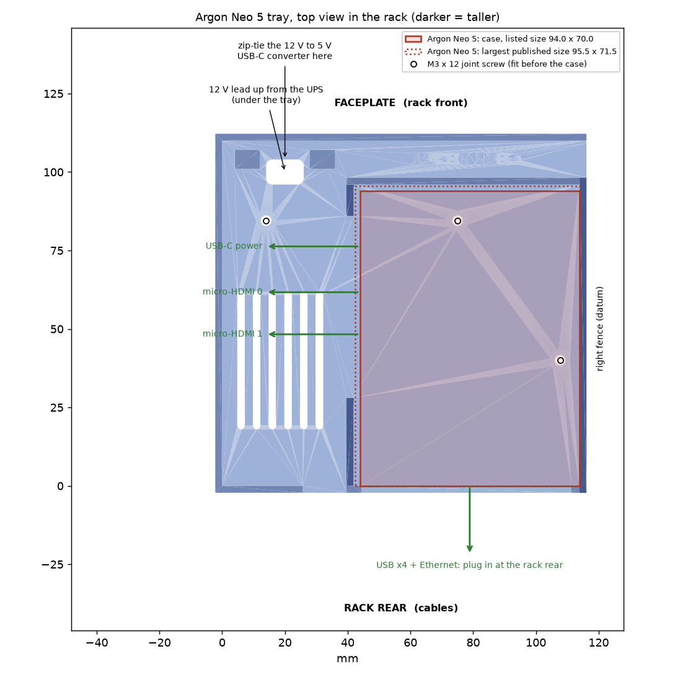

# Pi unit alternatives: Argon cases and other coolers (27 Oct 2026)

> **Updated 28 Oct (ultrareview).** These are the 27 Oct notes, written before the build was decided. The current plan is in `01_PRINT_FILES/README.md`: Poly+ 5 **with** this holder, after a **fit test** (do the adapter's own plugs reach the Pi through the case's side cut-outs?). If they do, the adapter's HDMI-A and 12 V terminal are used. **28 Oct change:** the holder base's rear wall is cut back 23 mm wide round the HDMI jack (`HDMI_RELIEF_W` in `source/waveshare_f_holder.py`): the old 18.6 mm notch stopped a 20–22 mm HDMI plug moulding 2.4 mm short. The holder check now tests the plugs: 26 PASS (`checks/VERIFICATION_waveshare_f_holder.txt`).

These files are for the case and cooler options in your Amazon cart. Each one is compared with the bare-board v3 case (plates 10 + 11) that the rack was designed around:
- Argon NEO 5
- Argon Poly+5 with THRML
- the official Raspberry Pi Active Cooler

**Pick one row.** Everything else in `PRINT_THIS/` stays the same.

| Your Pi 5 setup | Print | Instead of |
|---|---|---|
| Bare Pi + **GeeekPi Armor Lite V5** (the design as it stands) | plates 10 + 11 | nothing changes |
| Bare Pi + **official Raspberry Pi Active Cooler** | plates 10 + 11, **no new files** | nothing changes |
| Bare Pi + **Argon THRML 30 mm** cooler | plates 10 + 11, **no new files**, if the cooler stands ≤ 17 mm above the board (measure it) | nothing changes |
| Pi inside an **Argon NEO 5** | plate 10 + **`11A_…NEO-5…`** | plate 11 |
| Pi inside an **Argon Poly+5** (THRML inside it) | plate 10 + **`11B_…Poly+5…`** | plate 11 |

**Optional add-on to the Poly+5 row (added 27 Oct):** `11B-SIDE_PETG_Waveshare-F-holder_beside-Poly+5/` is a holder for the Waveshare adapter (F), so its NVMe and 2.5G Ethernet can still be used beside the case. It doesn't replace any plate. Read its `README.md` first: the adapter's plugs can't reach the Pi's ports through the case wall, so HDMI 0 and the Pi's power don't work through it, and the 12 V terminal is at the front, not the rear. Checks: `checks/VERIFICATION_waveshare_f_holder.txt`.

## Why the coolers need no new print
- **Active Cooler.** The official drawing gives 63.5 × 42.5 × 13.7 mm. Under the v3 lid there's 19.9 mm above the board, so it fits with at least 3.4 mm to spare. It sits inside the Pi's outline, clear of the adapter (F). Its fan intake falls under the lid's hex grill, and would still be covered if it sat 10 mm off.
- **THRML 30 mm.** Argon don't publish its height. It's a blower on a heatsink like the official cooler; one listing gives 9.6 mm for the heatsink alone. Measure it before fitting the lid: from the board to the top of the fan must be **17 mm or less**.

## The Argon trays (11A, 11B)

- **What it is.** One flat PETG tray, about 42 g, that replaces the board tray and lid. It has the same footprint and the same 3 joint holes, so it screws onto the **same UPS tray** with the same 3 × M3 × 12 countersunk screws. The shelf, UPS tray and faceplate don't change.
- **Case position.** The case sits in the rear-right corner:
  - Its USB/Ethernet end faces the rack rear, where the v3 ports were.
  - Its side ports (USB-C power, 2 × micro-HDMI) face an open area on the left, with 32 mm clear for the plugs.
- **What holds it.** Low fences, plus the double-sided foam tape that's already on the BOM.
- **Fit check.** The full rack check passes with the case in place: 39 PASS for each case. There's 13.4 mm of air between the case top and the B1 dock, enough for the case's top fan.
- **Each plate folder has:** `Plate11A.3mf` / `Plate11B.3mf` (tray + faceplate, already placed), the loose STLs, `SETTINGS.txt`, a bed picture and the plan above. The faceplate is plate 11's file; if you've already printed it, delete it from the plate in Bambu Studio and print just the tray.

### Measure the case first (that's why the folders say WAIT)
The sizes published for both cases disagree:

| Case | Size used | Tray takes up to | Published sizes found |
|---|---|---|---|
| NEO 5 | 94 × 70 × 30 | 96.0 × 72.0 | 94 × 70 × 30 (Tom's Hardware, Electrokit); 87.6 × 71.5 × 30 (Core, Little Bird); 93 × 68 × 27 (Botland); 95.5 × 71.5 × 30 |
| Poly+5 | 93.5 × 64 × 30 | 96.0 × 66.5 | 93.5 × 64 × 30 (seller listings that warn of 0–1 cm measuring error); no official figure |

- **Bigger than the "takes up to" size:** don't print yet. Ask Claude to widen the pocket.
- **Up to about 3 mm smaller:** fine as it is. Push the case into the rear-right corner and tape it down.
- **More than about 3 mm smaller:** it still works on the tape, or ask Claude for a snug version.

### What changes when the Pi is in an Argon case
- **Adapter (F) can't be used.** It plugs straight into the Pi's side sockets, and the case wall is in the way. That means losing what it provides: the NVMe SSD, the 2.5G PoE port and the 12 V screw terminal. You'd boot from the microSD (or a USB SSD) and use the Pi's own 1G Ethernet.
- **Power, two ways:**
  - **Keep the UPS backup (recommended).** UPS 12 V OUT → the right-angle DC pigtail → a **12 V to 5 V, 5 A USB-C step-down converter** → the Pi's USB-C.
    - The 12 V lead runs as before, out of the UPS tray's back window. It then turns left under the tray and comes up through the hole at the front-left.
    - Zip-tie the converter to the two anchors next to that hole.
    - Most cheap converters don't do USB-PD, so keep `usb_max_current_enable=1` in `config.txt` (rework-01 already sets it).
  - **Simpler, but no battery backup.** The official 27 W USB-C supply in your cart, straight into the Pi.
- **Screen HDMI.** Use the **UGREEN 20134** micro-HDMI extender. It's on the BOM as "optional", and the shelf already has its port tower. Plug it into micro-HDMI 0, snap its socket into the tower, and connect the flat HDMI cable to the screen from there, as before.
- **Fit order:**
  1. UPS into the UPS tray.
  2. Argon tray on top, with the 3 joint screws (two of them end up under the case).
  3. Feed the 12 V lead up through its hole.
  4. Stick the case down.
  5. Plug in the side cables.
  6. Shelf and faceplate as in `4_Pi_Unit_2U/README.md`.

## Ideas from Jeff Geerling's mini-rack list ([mini-rack.jeffgeerling.com](https://mini-rack.jeffgeerling.com/#standard))
**Your rack already meets his 10-inch standard:**

| | His standard | Your rack |
|---|---|---|
| Rail hole spacing | 236.525 mm | 236.525 mm |
| Vertical hole pattern | EIA | EIA |
| Clear width | about 220 mm | 224 mm |

So any community 10-inch mount on his list will bolt into your rails later. Use M5 screws with washers: printed mounts have slots sized for M6 or 10-32 screws.

**None of the printable designs on the list replaces anything in `PRINT_THIS`.** What's there:

| On the list | For you? |
|---|---|
| Printable rack frames: Lab Rax (5U), HomeRacker, Mod10, MiniRax, DeskPi's T-series models… | **No.** Your 9U T0-look frame is designed and checked around your four units. Switching frames means redesigning every mount. |
| DeskPi **2 × Pi 5 tray** (about 2U, for the T0/T1/T2; [GitHub](https://github.com/DeskPi-Team/3DPrint-Models/tree/main/3D_print_models/Model_17_2xRPi5_tray)) | **Only for a second, bare Pi 5** (e.g. with the Active Cooler). It has no room for the UPS or the adapter (F), and it needs 2 more U (an 11U rack). |
| **Pi Slice Rack** (2U, up to 10 bare Pis) | Only if you build a cluster later. |
| DeskPi 7" touch-screen case (Model 19) | **No.** It's for 52Pi's 7" screen, not your Waveshare (C). Keep plate 09 (Display7C). |
| Rack UPSs (APC, Tripp Lite), Pi UPS HATs (Geekworm X1200, PiSugar) | **No.** Your Cuzor 12 V UPS already has its tray (plate 10). |
| Blanking and vent panels, cable combs and brush panels | **Not needed.** All 9U are used and the back is open. |

**Not on his list, but they came up while checking the NEO 5:** two community 1U NEO 5 rack mounts.
- [MakerWorld 2889139](https://makerworld.com/en/models/2889139-10-1u-rack-mount-for-raspberry-argon-neo-5)
- [Printables 1463834](https://www.printables.com/model/1463834-neo5x2-and-neo5-nvme-10-rack-mount)

Their pages wouldn't open for checking. Either one needs its own U and has no room for the UPS. They're only worth it if the NEO 5 is for an *extra* Pi; for your main Pi, tray 11A keeps the UPS in the same 2U.

## Checks (27 Oct 2026, on the CAD models, not a physical test)
- `checks/VERIFICATION_alt.txt`: **29 PASS.** For both trays:
  - fit on the UPS tray, with the joint holes on its posts
  - the case pocket holds both the listed and the largest published size
  - the plug space at the side and rear
  - the 12 V lead hole
  - the STL itself
  - the air above the case

  Plus the cooler checks for the v3 case.
- `checks/VERIFICATION_rack_with_ArgonNEO5.txt`, `…ArgonPoly5.txt`: **39 PASS each.** This is the full rack check, with each tray in place of the board tray and the case in place of the lid.
- `checks/plate_layout_check.txt`: **8 PASS.** Both 3MFs were written, read back and checked on the 256 mm bed.

## Files and rebuilding
- `STEP_for_Onshape/`: the trays in the v3 assembly frame.
- `source/argon_tray.py`: the tray model. The case sizes are in `CASES` at the top.
- To rebuild with the CadQuery venv, from `source/`:
  1. `python argon_tray.py <out>`
  2. `python verify_alt.py <v7.2 bundle> <out>`
  3. `build_alt_plates.py <v7.2 bundle> <out> <dest>`

  The rack check is the bundle's `verify_rack_t0.py`, run on `<out>/checks/rack_step_NEO5` (or `_POLY5`).
