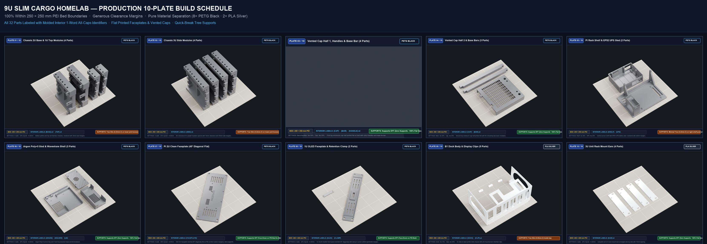

# 9U Slim Cargo Homelab: Production 10-Plate Build Schedule (250 × 250 × 250 mm Bed)

This directory contains the verified, production-ready 3D print suite for the **9U Slim Cargo (140 mm Depth) Homelab**, specifically engineered for **250 × 250 × 250 mm build volume 3D printers** (Bambu Lab X1C / P1S / P1P / A1, Voron 250, Creality K1, Prusa MK4/XL, Anycubic Kobra).

> **Bed Safety & Clearance Verification**: Every single part has been geometrically verified to sit **100% inside the 250 × 250 mm bed boundaries** with generous safety margins ($\ge 13\text{ mm}$ to $58\text{ mm}$ on multi-part plates, and $4.9\text{ mm}$ on the full diagonal 2U faceplate).  
> **True Flat Orientations**: Vented cap halves and front faceplates are oriented **flat face-down directly on textured PEI spring steel** ($Z = 4\text{ mm}$ to $22\text{ mm}$), ensuring zero supports on cosmetic surfaces, zero wobble, and clean bridging across all vent slots.

---

## 🖼️ Complete 10-Plate Master Schedule Poster

---

## 🚀 Quick Start
* **Direct Slicer Import**: Open any `.3mf` file in **Bambu Studio**, **OrcaSlicer**, or **PrusaSlicer**. All 32 parts are positioned, grounded to $Z=0$, and spaced with safe clearances.
* **Pure Material Separation**: 
  - **Plates 01 to 08**: 100% **PETG Black** (23 physical pieces: Frame uprights, rails, crossbars, caps, shelves, trays, and front faceplates).
  - **Plates 09 & 10**: 100% **PLA Silver** (9 physical pieces: B1 dock chassis sled, display clips, and 3U rack mount ears).
  - Zero mid-plate filament purges; print all 8 PETG plates consecutively, then swap spool once for PLA.
* **Photorealistic 3D Renders**: High-resolution 3D renders with slicer parameter cards are available in [`Plate01_3D_RENDER.png`](Plate01_3D_RENDER.png) through [`Plate10_3D_RENDER.png`](Plate10_3D_RENDER.png).
* **Molded Interior Part Identifiers**: Every part features an all-caps one-word deboss on non-cosmetic interior surfaces (`BASE`, `SIDE`, `TOP`, `BAR`, `CAP`, `HANDLE`, `ARGON`, `SHELF`, `UPS`, `HOLDER`, `LID`, `FACEPLATE`, `OLED`, `CLAMP`, `DOCK`, `CLIP`, `EAR`) corresponding directly to Lego-style assembly guides.

---

## ⚡ Quick-Break Support System

| Setting | PETG Black Plates (01–08) | PLA Silver Plates (09–10) | Why This Setting Matters |
|---|:---:|:---:|---|
| **Support Type** | **Tree (auto)** / *Tree Slim* | **Tree (auto)** / *Tree Slim* | Branches grow only to overhang contact points; zero blocky accordion infill. |
| **Top Contact Z-Distance** | **`0.22 mm`** *(Crucial)* | **`0.20 mm`** | Standard 0.16–0.18 mm welds to PETG. `0.22 mm` lets the interface solidify without fusing. |
| **Top Interface Layers** | **2 dense layers** | **2 dense layers** | Creates a rigid contact pad that peels off cleanly in one single piece. |
| **Interface Pattern & Spacing** | Rectilinear · **0.8 mm** | Rectilinear · **0.8 mm** | Prevents filament strands from sagging into the part. |
| **Overhang Angle Threshold** | **`55°`** | **`55°`** | Only true overhangs get supported; 45° chamfers and joint bosses print unsupported. |
| **XY Separation Distance** | **`0.60 mm`** | **`0.50 mm`** | Prevents tree support trunks from sticking to vertical sidewalls. |

---

## 📋 Complete 10-Plate Schedule Breakdown

| Plate | 3MF Project File | Material | Parts on Bed | Clearances & Margins | Support Recipe | Debossed Labels |
|:---:|---|:---:|:---:|:---:|---|---|
| **01** | [`Plate01_Chassis_2U_Base_and_1U_Top_Modules_4_Parts.3mf`](Plate01_Chassis_2U_Base_and_1U_Top_Modules_4_Parts.3mf) | PETG Black | **4 Parts** | Left: 35 mm · Right: 24 mm Bottom: 30 mm · Top: 113 mm | Tree Slim ($0.22\text{ mm}$ Z) on lower joint alignment bosses. | `BASE` (x2) `TOP` (x2) |
| **02** | [`Plate02_Chassis_3U_Side_Modules_4_Parts.3mf`](Plate02_Chassis_3U_Side_Modules_4_Parts.3mf) | PETG Black | **4 Parts** | Left: 35 mm · Right: 58 mm Bottom: 56.8 mm · Top: 56.8 mm | Tree Slim ($0.22\text{ mm}$ Z) on lower joint bosses. | `SIDE` (x4) |
| **03** | [`Plate03_Vented_Cap_Half_1,_Handles_and_Base_Bar_4_Parts.3mf`](Plate03_Vented_Cap_Half_1,_Handles_and_Base_Bar_4_Parts.3mf) | PETG Black | **4 Parts** | Left: 13 mm · Right: 13.6 mm Bottom: 15 mm · Top: 60 mm | **Supports OFF**: Cap printed flat ($Z = 22\text{ mm}$); vents bridge cleanly. | `CAP` `BAR` `HANDLE` (x2) |
| **04** | [`Plate04_Vented_Cap_Half_2_and_Base_Bars_3_Parts.3mf`](Plate04_Vented_Cap_Half_2_and_Base_Bars_3_Parts.3mf) | PETG Black | **3 Parts** | Left: 13 mm · Right: 13.6 mm Bottom: 15 mm · Top: 30 mm | **Supports OFF**: Cap printed flat ($Z = 22\text{ mm}$); crossbars print flat. | `CAP` `BAR` (x2) |
| **05** | [`Plate05_Pi_Rack_Shelf_and_EP52_UPS_Sled_2_Parts.3mf`](Plate05_Pi_Rack_Shelf_and_EP52_UPS_Sled_2_Parts.3mf) | PETG Black | **2 Parts** | Left: 40 mm · Right: 39.9 mm Bottom: 15 mm · Top: 13.6 mm | Minimal Tree ($0.22\text{ mm}$ Z) under shelf post cable notch. | `SHELF` `UPS` |
| **06** | [`Plate06_Argon_Poly+5_Sled_and_Waveshare_Shell_3_Parts.3mf`](Plate06_Argon_Poly+5_Sled_and_Waveshare_Shell_3_Parts.3mf) | PETG Black | **3 Parts** | Left: 20 mm · Right: 34 mm Bottom: 15 mm · Top: 17.4 mm | **Supports OFF**: All trays and screen shell print flat. | `ARGON` `HOLDER` `LID` |
| **07** | [`Plate07_Pi_2U_Clean_Faceplate_45deg_Diagonal_Flat.3mf`](Plate07_Pi_2U_Clean_Faceplate_45deg_Diagonal_Flat.3mf) | PETG Black | **1 Part** | $240.2 \times 240.2\text{ mm}$ bounding box $4.9\text{ mm}$ margin on all 4 corners | **Supports OFF**: Printed flat face-down on textured PEI for a matte finish. | `FACEPLATE` |
| **08** | [`Plate08_1U_OLED_Faceplate_and_Retention_Clamp_2_Parts.3mf`](Plate08_1U_OLED_Faceplate_and_Retention_Clamp_2_Parts.3mf) | PETG Black | **2 Parts** | $209.2 \times 209.2\text{ mm}$ bounding box $20.4\text{ mm}$ perimeter margin | **Supports OFF**: Faceplate printed flat face-down on textured PEI. | `OLED` `CLAMP` |
| **09** | [`Plate09_B1_Dock_Body_and_Display_Clips_5_Parts.3mf`](Plate09_B1_Dock_Body_and_Display_Clips_5_Parts.3mf) | PLA Silver | **5 Parts** | Left: 18 mm · Right: 18 mm Bottom: 20 mm · Top: 66 mm | Tree Slim ($0.20\text{ mm}$ Z) inside dock rear cavity. Clips print flat. | `DOCK` `CLIP` (x4) |
| **10** | [`Plate10_3U_Unit_Rack_Mount_Ears_4_Parts.3mf`](Plate10_3U_Unit_Rack_Mount_Ears_4_Parts.3mf) | PLA Silver | **4 Parts** | Left: 35 mm · Right: 52 mm Bottom: 58.7 mm · Top: 58.7 mm | **Supports OFF**: Printed 100% flat on bed surface. | `EAR` (x4) |
| **TOTAL** | **10 Production 3MF Projects** | **Pure Separation** | **32 Pieces** | **100% Inside 250 mm Bed Bounds** | — | **All 17 Unique Models** |
