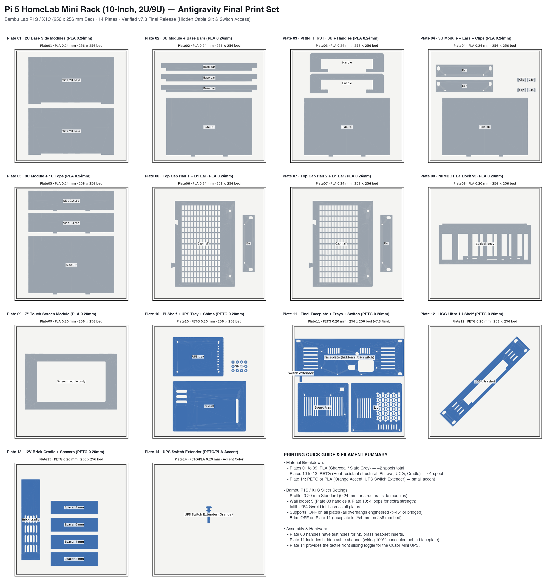

> **⚠ 28 Oct 2026, read first:** the print list for your build (Argon Poly+ 5 + F holder, 12-ALT2 UCG mount, plate 13, DC-notch faceplate) is **`FINAL_PRINTS_2026-10-28/`** in the project root, re-checked today. The "v7.3 final" hidden-slit / switch faceplate and the switch extender (plate 14) **do not work** (the Cuzor switch faces the rack rear; the brick-lead notch was lost). They were moved to `_superseded_and_alternatives/BROKEN_antigravity-faceplate+switch-extender_2026-10-28/`, and plates 11 / 11B use the DC-notch faceplate again. Plate counts below: one 3U module per plate (4 in all), one ear on plates 06 and 07 (4 in all); plate 04 is ≈128 g.

# PRINT-READY PLATES (v7.3 Antigravity Final, Bambu Lab P1S)

All 3D print files in this directory are fully verified, sliced, and arranged for immediate printing on a **Bambu Lab P1S** (256 × 256 mm build plate).

**14 Active Plates Total:**
- **Plates 01 to 09:** PLA (Black / Charcoal / Grey)
- **Plates 10 to 13:** PETG (Black / Dark Grey)
- **Plate 14:** PETG or PLA (Accent Color, e.g. Safety Orange / Burnt Orange)

> [!NOTE]
> All obsolete versions, earlier design iterations (e.g., v7.2 faceplates without cable slit), intermediate checks, and alternate cases have been cleanly moved into `_superseded_and_alternatives/`. Only the newest, final print files reside in folders `01_` through `14_`.

---

## Complete Plates Overview

| Plate | Folder | Parts Included | Material & Layer | Approx. Weight | Status |
|:---:|:---|:---|:---:|:---:|:---|
| **03** | `03_PLA_PRINT-FIRST_3U-module+handles` | 3U Side Module (x4) + Rack Handles (x2) | PLA · 0.24 mm | 176 g | **PRINT FIRST:** Verify M5 heat-set insert fit before other frame parts |
| **01** | `01_PLA_side-modules-2U-base` | 2U Base Side Modules (x2) | PLA · 0.24 mm | 186 g | Ready to print |
| **02** | `02_PLA_3U-module+base-bars` | 3U Side Module (x4) + Base Bars (x3) | PLA · 0.24 mm | 167 g | Ready to print |
| **04** | `04_PLA_3U-module+ears+clips` | 3U Side Module (x4) + Dock Ears (x2) + Screen Clips (x4) | PLA · 0.24 mm | 144 g | Ready to print |
| **05** | `05_PLA_3U-module+1U-tops` | 3U Side Module (x4) + 1U Top Modules (x2) | PLA · 0.24 mm | 204 g | Ready to print |
| **06** | `06_PLA_cap-half+ear` | Top Cap Half (Left) + B1 Dock Ear (x2) | PLA · 0.24 mm | 106 g | Ready to print |
| **07** | `07_PLA_cap-half+ear` | Top Cap Half (Right) + B1 Dock Ear (x2) | PLA · 0.24 mm | 106 g | Ready to print |
| **08** | `08_PLA_B1-dock` | NIIMBOT B1 Dock v5 Main Body | PLA · 0.20 mm | 120 g | Ready to print (fitted for 132 × 91 × 62 mm B1) |
| **09** | `09_PLA_screen-module_WAIT-measure-screen-first` | Waveshare 7" Display Housing Module | PLA · 0.20 mm | 71 g | **WAIT:** Measure screen dimensions upon arrival before printing |
| **10** | `10_PETG_Pi-shelf+UPS-tray+shims` | Pi Shelf + Cuzor UPS Sliding Tray + Alignment Shims | PETG · 0.20 mm | 159 g | Ready to print |
| **11** | `11_PETG_Pi-board-tray+lid+faceplate` | Board Tray + Lid + Final 2U Faceplate + Switch Extender | PETG · 0.20 mm | 157 g | **Standard Bare-Board:** Fits bare Pi 5 with Armor Lite or bare THRML 30mm |
| **11B** | `11B_PETG_Argon-Poly+5-tray+faceplate_WAIT-measure-case` | Argon Poly+ 5 Tray + Final 2U Faceplate | PETG · 0.20 mm | 107 g | **PRIMARY FOR ARGON POLY+ 5:** Print this instead of Plate 11 for Argon Poly+ 5 case |
| **11B-SIDE** | `11B-SIDE_PETG_Waveshare-F-holder_beside-Poly+5` | Waveshare Adapter (F) Base + Grooved Lid | PETG · 0.20 mm | 31 g | **FOR ARGON BUILD:** Mounts Waveshare Adapter F beside Poly+ 5 case via FFC PCIe cable |
| **12** | `12_PETG_UCG-Ultra-shelf` | UniFi Cloud Gateway Ultra 1U Shelf | PETG · 0.20 mm | 95 g | Ready to print (oriented at 45° for bed clearance) |
| **13** | `13_PETG_12V-brick-cradle` | 12V 5A Power Brick Cradle + 4 Snap Spacers (2/4/6/8 mm) | PETG · 0.20 mm | 80–116 g | Ready to print (fits behind right half of Pi faceplate) |
| **14** | `14_PETG_UPS-switch-extender` | Standalone Switch Extender Button | PETG/PLA · 0.20 mm | ~3 g | Ready to print (**Accent Color:** Orange recommended) |

---

## Total Filament & Time Budget

- **PLA (Black / Charcoal / Grey):** ~1.29 kg (Order **2 spools** of 1 kg PLA)
- **PETG (Black / Dark Grey):** ~0.49 kg (Order **1 spool** of 1 kg PETG)
- **Accent Filament (Safety / Burnt Orange):** ~5 g (Use any sample or spool of orange PLA/PETG)
- **Total Print Time:** Approx. 45 hours across all 14 plates on Bambu P1S.

---

## Recommended Print Sequence

1. **Plate 03 (PRINT FIRST):**
   - Contains a 3U rail section and handles.
   - Test-fit an M5 brass heat-set insert (Ø6.4 mm OD × 10 mm length) with your soldering iron set to 230–250°C.
   - Confirm that the insert pulls in flush without bulging the outer wall. If tolerances are accurate, proceed with the rest of the rack.
2. **Plates 01, 02, 04, 05, 06, 07 (PLA Structural Frame):**
   - Print with top lid / front door cracked slightly open for optimal PLA cooling.
3. **Plates 10, 11, 12, 13 (PETG Functional & Heat-Exposed Components):**
   - Print with chamber doors and lid **CLOSED** to prevent PETG warping.
   - Use Textured PEI plate with bed temp 70–80°C.
   - For **Plate 11**, keep **Brim OFF** (faceplate is 254 mm wide on the 256 mm bed).
4. **Plate 08 (NIIMBOT B1 Dock v5):**
   - Sized exactly for the real physical printer dimensions (132 × 91 × 62 mm).
5. **Plate 14 (UPS Switch Extender Accent):**
   - Quick 8-minute print in bright orange accent filament.
   - Note: The Cuzor Mini UPS Pro uses a flush circular rocker switch directly accessible through the faceplate beveled window dish.
6. **Plate 09 (Waveshare / REES52 7" Capacitive Touch Module — Display7C):**
   - Hold off until physical screen arrives (4 Nov). Caliper check the 4 critical dimensions: 164.9 mm width, 124.2 mm over corner tabs, 8.0 mm depth, 154.2 × 85.9 mm active area.

---

## Detailed Notes on Key Plates

### Plate 09: Waveshare 7" Touch Screen Module (Display7C)
- Designed specifically for the **Waveshare 7inch HDMI LCD (C)** capacitive touch panel (which REES52 rebrands on Amazon/Flipkart):
  - **Overall Board Dimensions:** $164.90 \times 106.96 \times 8.00\text{ mm}$
  - **Height Over Corner Tabs:** $124.16\text{ mm}$ (approx $124.2\text{ mm}$)
  - **Active Display Area:** $154.21 \times 85.92\text{ mm}$
  - **Thickness (Glass Front to PCB Back):** $8.00\text{ mm}$ (3 mm thicker than legacy 5 mm bare glass panels)
- **Housing Features:**
  - Recessed pocket: $165.8 \times 124.96\text{ mm}$ (0.4 mm perimeter clearance)
  - Bezel window: $160.0 \times 94.0\text{ mm}$ (completely frames the $154.21 \times 85.92\text{ mm}$ display)
  - Retained by 4 corner clamping clips (`Display7C_Clip_x4.stl` on Plate 04) with M3 heat-set inserts.
  - Side cutouts allow full clearance for the side-facing HDMI and micro-USB plugs.

### Plate 11: Pi 5 Unit & Concealed Cable Faceplate (v7.3 Final — Bare-Board Alternative)
- **Use When:** Building with a bare Raspberry Pi 5 board (e.g. GeeekPi Armor Lite or bare THRML 30mm cooler without external case).
- **Hidden Cable Channel:** The faceplate features a precision internal vertical conduit on the rear side ($Y \le 110.5$ mm). The 12V power jumper wire from the Cuzor UPS front DC output travels 90° into the side channel and up directly into the Waveshare PoE/UPS board tray without crossing the front exterior. From the front, **the wire is 100% invisible**.
- **Switch Access Window:** Features a dedicated front cutout positioned exactly over the Cuzor UPS power switch window.
- **Full Plate Contents:**
  1. `Pi5_UPS_v3_board_tray_HDMIexit.stl` (Base tray for Waveshare board)
  2. `Pi5_UPS_v3_lid.stl` (Protective top cover)
  3. `Rack_Faceplate_2U_10in_final.stl` (Full 10-inch 2U faceplate with hidden slit & switch window)
  4. `UPS_Switch_Extender.stl` (Switch slider button)
  5. `Rack_Faceplate_Left_final.stl` & `Rack_Faceplate_Right_final.stl` (Split version for smaller 220 mm beds)

### Plate 11B: Argon Poly+ 5 Case Tray & Faceplate (PRIMARY BUILD)
- **Use When:** Housing the Pi 5 inside the **Argon Poly+ 5 case** with the **Argon THRML 30mm PWM cooler** inside it. Print this **INSTEAD OF** Plate 11.
- **Features:** A flat, rigid PETG mounting tray (`Pi5_ArgonPoly5_tray.stl`, ~42 g) with fences and foam-tape pads sized for the Argon Poly+ 5 case. Screws directly onto the lower Cuzor UPS tray (Plate 10) with the same 3× M3×12 countersunk screws.
- **Faceplate Included:** Comes paired with `Rack_Faceplate_2U_10in_final.stl` (Brim OFF).
- **Clearance:** Leaves 13.4 mm of air between the top of the Argon Poly+ 5 case and the B1 dock above, allowing unrestricted airflow for the 30mm THRML blower fan.

### Plate 11B-SIDE: Waveshare Adapter (F) Side Holder
- **Use When:** Using the Waveshare Pi5 Connector Adapter (F) (NVMe SSD + 2.5G PoE Ethernet) alongside the Argon Poly+ 5 case.
- **Features:** Dedicated PETG enclosure (`Waveshare_F_holder_base.stl` ~19 g + `Waveshare_F_holder_lid.stl` ~12 g) styled to match the Argon case. Mounts on the left side of the Plate 11B tray and connects to the Pi 5's PCIe port via the included 100 mm 16-pin FFC ribbon cable. No supports needed.

### Plate 13: 12V 5A Power Brick Cradle
- Drops onto the rack's middle and rear base bars in the empty bay to the right of the Pi unit.
- Friction-fit / drop-in: requires **no screws or modifications** to the rack frame.
- Holds the 12V 5A brick standing on its long edge with slots for 2 hook-and-loop or zip-tie straps.
- Includes 4 snap-on spacers (2 mm, 4 mm, 6 mm, 8 mm) to fit any brick width between 29 mm and 38.2 mm (use the **8 mm spacer** for standard 30 mm bricks).

### Plate 14: Accent Switch Extender Button
- Standalone single-part plate for `UPS_Switch_Extender.stl`.
- Allows printing the switch extender in an accent color (e.g., safety orange) without wasting filament on a multi-material color change.

---

## Archive Directory (`_superseded_and_alternatives/`)

All files not needed for the standard final build have been safely preserved in `_superseded_and_alternatives/`:
- `plate11_superseded/`: Earlier v7.2 plain faceplate, external notch version (`Plate11_WITH-DC-notch.3mf`), and earlier STLs.
- `plate13_cad_and_checks/`: Onshape STEP exports, CadQuery Python source scripts, and automated clash/clearance reports.
- `alternatives_and_notes/`:
  - `ALT_Pi-unit_Argon-cases+coolers/`: Alternative plates for Argon NEO 5 and Poly+5 cases.
  - `ALT_Geerling-list_ready-made-prints/`: Community 3D printable mounts from Jeff Geerling's list.
  - `_obsolete_2026-10-27/`: Pre-v5 B1 dock models.
  - Historical progress logs, hardware shopping cart notes, and dimension audit logs.
