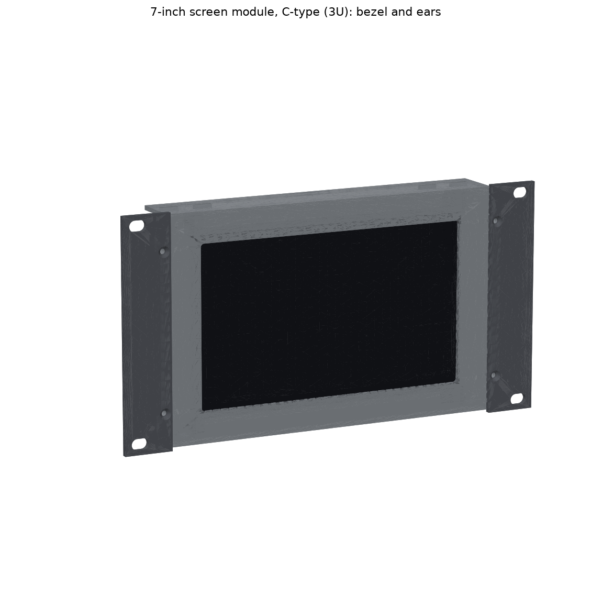
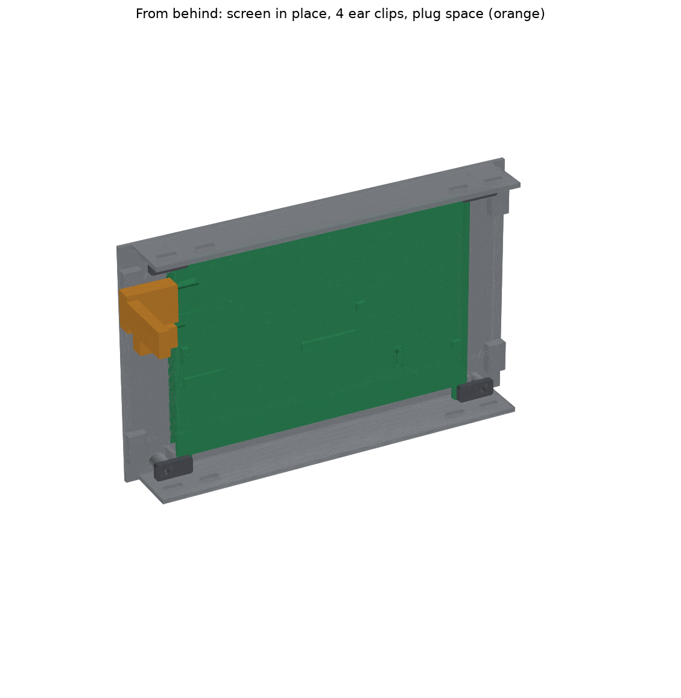

# 7-inch Screen Module, C-type — 10-inch 3U (27 Oct)

This replaces `3_Display_7in_3U/` from the v7 bundle **if your REES52 screen is the kind shown in its Amazon photo**: four corner tabs with holes that stick out past the glass. That is the Waveshare **7inch HDMI LCD (C)** layout. Its driver board is bonded to the back of the glass, and its HDMI and micro-USB sockets face sideways out of one short edge.

The v7 module was drawn for bare 165 × 100 × 5 mm glass with a separate driver board, so this screen won't go into it.




## Check your screen first (2 minutes with calipers)
The module is built on **Waveshare's own 3D model** of the (C) screen (`Component_Models/Waveshare_7inch_HDMI_LCD_C.step`). Measure these four things on yours. If each is within about ±0.5 mm, print.

| What | Model value |
|---|---|
| Width | **165.0 mm** |
| Height over the corner tabs | **124.2 mm** |
| Glass front to the back of the board (not counting the sockets) | **8.0 mm** |
| Each corner tab: strip from 77 to 82.5 mm out from the centre, ending 53.5 mm above or below the centre | about 5.5 mm wide, 8.5 mm long |

If it's different, change `SCR_W`, `SCR_H` and `BOARD_BACK` (and `EAR_X` / `EAR_Y0`) at the top of `source/display.py`, then re-run the two scripts below.

## How it holds the screen
- **Face down on the bezel.** The window is 160 × 94 mm. It shows the whole active area (154.2 × 85.9) even if the panel sits up to 2.9 mm (sideways) or 4 mm (up/down) off centre, and it still covers the glass edge.
- **Located by the top and bottom flanges and four corner walls**, to within 0.5 mm.
- **Held by four small clips** that press the corner tabs through 1 mm foam tape, each with one M3 screw into a boss.
- **Both sides are open behind the bezel**, so the HDMI and USB plugs fit whichever way up the screen goes.
- **No driver tray.** The driver is on the screen's back, so the module is 30 mm deep instead of 70.

## Print
PLA or PETG, 3 walls, 15 % infill, **no supports**. The body prints bezel face down; everything rises from the bed.

| File | Qty | On the bed | ≈ g (PLA / PETG) |
|---|---|---|---|
| `Display7C_3U_Body.stl` | 1 | 214 × 130 × 30 mm, bezel face down | 71 / 73 |
| `Display7C_Clip_x4.stl` | 4 | 20 × 9 × 3 mm, flat | 0.6 each |
| `B1_Dock_3U_Ear_x2.stl` (from the dock's folder, as before) | 2 | flat | 10 |

That's about 28 g less than the v7 screen body.

## Hardware (same as before)
| Item | Qty |
|---|---|
| M3 heat-set inserts (Ø4 hole, 6 deep) | 8 (4 ears, 4 clip bosses) |
| M3 × 8 countersunk | 4 (ears) |
| M3 × 8 button head | 4 (clips) |
| 1 mm foam tape | a patch on each corner tab |
| M5 × 12 + washers (rack screws) | 4 |

## Wiring
- **HDMI:** use the flat 50 cm cable from your cart. Plug it into the screen's side socket and **fold the flat cable straight back** at the plug. That fits inside the rack's ±112 mm opening. A thick round HDMI cable's plug sticks out about 30 mm and runs into the rack post. If you must use one, add a 90° HDMI adapter that points the cable to the back.
- **Touch + power:** one micro-USB cable (USB-A to micro-B, **1 m**) from the screen's touch socket to a Pi USB port at the rear of the bottom unit. The route down the side channel is 40–50 cm, so a 50 cm cable leaves no slack. Waveshare rates this screen at 5 V, about 0.5 A (2.5 W). The Pi can power it, and no separate 5 V adapter is needed.
- **Low-power USB warning:** if the Pi limits USB current (a "USB current limited" notice), add `usb_max_current_enable=1` to `/boot/firmware/config.txt`.

## Checks
- **`VERIFICATION_display7c.txt`: 23 PASS, 0 FAIL.** These run against the Waveshare model, both ways round, and cover:
  - the screen's fit and how it seats on the bezel
  - locating play, and clip pressure on the tabs
  - plug clearance
  - the window and how much glass the bezel covers
  - the inserts, the 3U and rail limits, and the bed size
- **`VERIFICATION_rack_with_display7c.txt`: 34 PASS, 0 FAIL.** This is the T0-look rack's full check (v7.0 rack files) with this module, the screen model and the plug spaces in place. The checks cover collisions with the rack and the other units, the ear slots on the rail inserts, cap clearance and tipping.

These are calculations on 3D models, not a physical test, so do the four-number check above first.

## Regenerate
```
cd source
python export_display.py ..     # STLs, STEPs, images
python verify_display.py        # writes VERIFICATION_display7c.txt
```
`display.py` keeps the function names the rack scripts call: `body()`, `clips()`, `ear()`, `glass_dummy()` (now the whole screen model) and `driver_dummy()` (now the plug spaces). Copy it and the STEP over the rack's `source/display.py` and `verify_rack_t0.py` picks it up.
