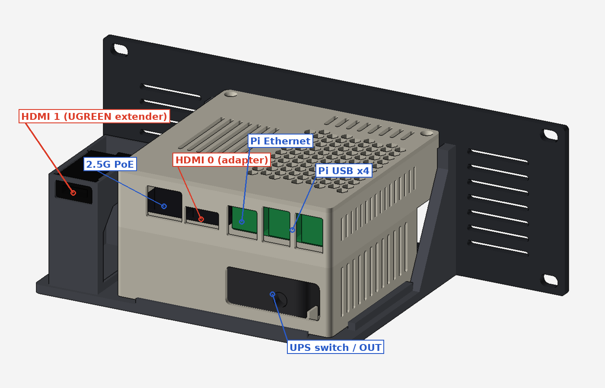

# Pi 5 Mini Server — 10-inch 2U Rack Unit

Raspberry Pi 5 (8 GB), Waveshare Pi5 Connector Adapter (F) with 2.5G PoE, an EVM 512 GB 2230 NVMe SSD, a GeeekPi Armor Lite V5 cooler and a Cuzor Mini UPS Pro 12 V. They are housed in the v3 stacked case, mounted on a 10-inch 2U rack faceplate and shelf.

The unit stands on a desk now and bolts into any 10-inch mini rack later.

**Overall size:** 254 W × 121 D × 88.1 H mm (2U).

---

## What's in this zip

| Folder | Contents |
|---|---|
| `1_Rack_Build_PRINT_THIS/` | **The build.** `STL_for_printing/`, `STEP_for_Onshape/` (including a full assembly), `images/`, `docs/` (verification report, original v3 notes) and `source/` (the scripts that generate everything) |
| `2_Upright_Stand_OLD/` | The earlier upright stand. It is not rack-friendly and is kept only for reference. |
| `3_Component_Models/` | One-part STEP models of each component, for designing in Onshape |

---

## Ports

| Side | Ports (left to right, seen from that side) |
|---|---|
| **Rear** (cables) | HDMI 1 (UGREEN extender), 2.5G PoE, HDMI 0 (adapter), Pi Ethernet, Pi USB × 4. Below them: the UPS switch, LED and 12 V OUT. |
| **Front** (faceplate) | Pi power button (press with a ~25 mm pin), 12 V DC-IN to the UPS, vents |

---

## Print list

PETG, 0.2 mm layers, 3 walls, 20 % infill, **no supports**.

| File (`STL_for_printing/`) | Qty | Bed | Orientation |
|---|---|---|---|
| `Pi5_UPS_v3_ups_tray.stl` | 1 | 120 mm | floor down |
| `Pi5_UPS_v3_board_tray_HDMIexit.stl` | 1 | 120 mm | floor down. Use this instead of the original v3 board tray. |
| `Pi5_UPS_v3_lid.stl` | 1 | 120 mm | top face down |
| `Pi5_UPS_v3_shims.stl` | 1 set | 120 mm | as is (4 each of 0.5, 1 and 2 mm) |
| `Rack_Shelf.stl` | 1 | 220 mm | base down (the HDMI port tower is part of it) |
| `Rack_Faceplate_2U_10in.stl` | 1 | **256 mm** | front face down |
| *or* `Rack_Faceplate_Left.stl` + `Rack_Faceplate_Right.stl` | 1 + 1 | 220 mm | front face down; each half screws to the shelf |

---

## Hardware

| Item | Qty | Where |
|---|---|---|
| M3 × 12 countersunk | 3 | UPS tray to board tray (from inside the board tray) |
| M3 × 8 countersunk | 2 | lid (back edge) |
| M2.5 × 8 screws | 4 | Pi 5. These self-tap into 2.2 mm pilots; for heat-set inserts, drill the pilots to 3.6 mm. |
| M2.5 × 10 screws + printed shims | 4 | Waveshare adapter |
| M3 heat-set inserts (Ø4) | 6 | shelf posts (4) and shelf front lip (2) |
| M3 × 8 countersunk | 6 | faceplate to shelf |
| Rubber feet, Ø10 mm | 4 | under the shelf |
| Double-sided foam tape | — | on the UPS ribs |
| Right-angle 5.5 × 2.1 mm DC plug lead | 1 | UPS OUT to the adapter's 7–24 V screw terminal |
| 12 V **≥ 3 A** power brick (5.5 × 2.1) | 1 | into the UPS DC-IN |
| M6 rack screws + cage nuts | 4 | later, when racked |

---

## Assembly

1. **UPS:**
   - Stick foam tape on the ribs of the UPS tray.
   - Set the UPS in with its switch end on the right.
   - Switch it ON.
2. **Trays:** place the board tray on the UPS tray and fit the 3 × M3 × 12 joint screws from inside.
3. **Pi:** screw the Pi 5 onto its four bosses, then fit the Armor Lite V5.
4. **Adapter:**
   - Plug it fully into the Pi.
   - Slide shims under each hole until each one just touches the board without lifting it.
   - Mark each spot through the hole and drill a 2.0 mm pilot into the solid pad.
   - Screw the adapter down.
5. **Inside connections:**
   - Fit the PCIe FFC and the 2230 NVMe SSD.
   - Run the 12 V lead from UPS OUT through the right channel and out the back window, then up through the board-tray floor hole. Follow the cable-tie anchors to the screw terminal.
   - **Check polarity.**
6. **HDMI extender:**
   - Plug the UGREEN micro-HDMI end into the Pi's free micro-HDMI port.
   - Lead the cable out through the slot in the board tray's left wall.
7. **Lid:** hook the two front teeth in, lower the lid and fit the 2 × M3 × 8 back screws.
8. **Shelf:**
   - Press in the 6 heat-set inserts and stick on the rubber feet.
   - Snap the UGREEN HDMI end into the port tower from the top, socket facing the rear.
   - Set the case into the four foot sockets.
9. **Faceplate:** screw it onto the shelf with 6 × M3 × 8.
10. **Power:** plug the 12 V brick into the UPS through the faceplate's DC-IN window.

---

## Before you print or power up

- **Free micro-HDMI:** the adapter's edge sits ~1 mm from the Pi. Before printing, confirm the UGREEN micro plug seats in the free port with the adapter fitted.
- **One power source only:** feed the adapter from the UPS (screw terminal) **or** from PoE, not both. With the UPS, plug the 2.5G port into a non-PoE switch port.
- **Current budget:** at full load the Pi draws ~2.5 A at 12 V, against the UPS's 3 A limit. Use a 12 V brick of at least 3 A.
- **HATs:** none fit under the v3 lid with the Armor Lite fitted, because a HAT would reach ~64.6 mm against a 63.4 mm lid. A 5–10 mm lid riser would fix this, and the rack leaves 14 mm of headroom.
- **UGREEN end size:** the holder assumes 23 × 12 × 38 mm. Measure yours; if it differs, edit `HF_W`, `HF_H` and `HF_L` in `source/rack.py` and re-run it.

---

## Verification

Every part was checked on the exported geometry; the full report is `1_Rack_Build_PRINT_THIS/docs/VERIFICATION.txt`.

- **38 PASS:**
  - 10-inch rack standard: panel, M6 slot pitch and positions, rail clearance.
  - No interference across all 45 part pairs.
  - All rear ports and front openings unobstructed.
  - Power-button path open; 12 V cable route clear.
  - Airflow: lid grill over the fan, 5.5 mm air gap over the UPS, 10 mm side channel, all vents open.
  - Extender socket and cable route.
  - Every part fits its print bed.
- **1 FAIL:** HAT clearance (see above).
- **1 WARN:** power-source note (see above).
- **2 UNVERIFIED:** the screw terminal position and whether the free micro-HDMI can be reached. Both depend on the adapter's component layout, which isn't in these files.

## Regenerating

Install CadQuery with `pip install cadquery`. Then, from `1_Rack_Build_PRINT_THIS/source/`:

- `python3 rack.py` rebuilds the faceplate, the shelf and the patched board tray.
- `python3 verify.py` re-runs every check.

`case_v3.py` (build123d) is the original v3 case script with the cable exit added.
