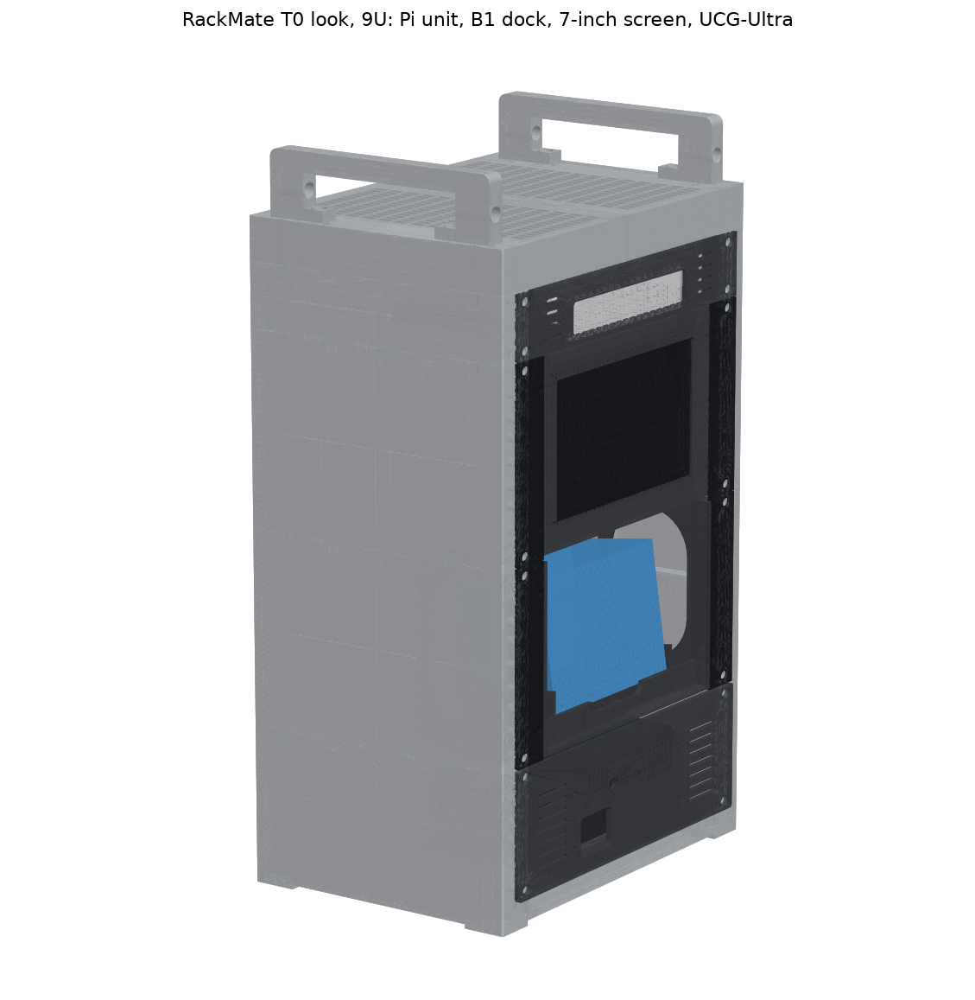
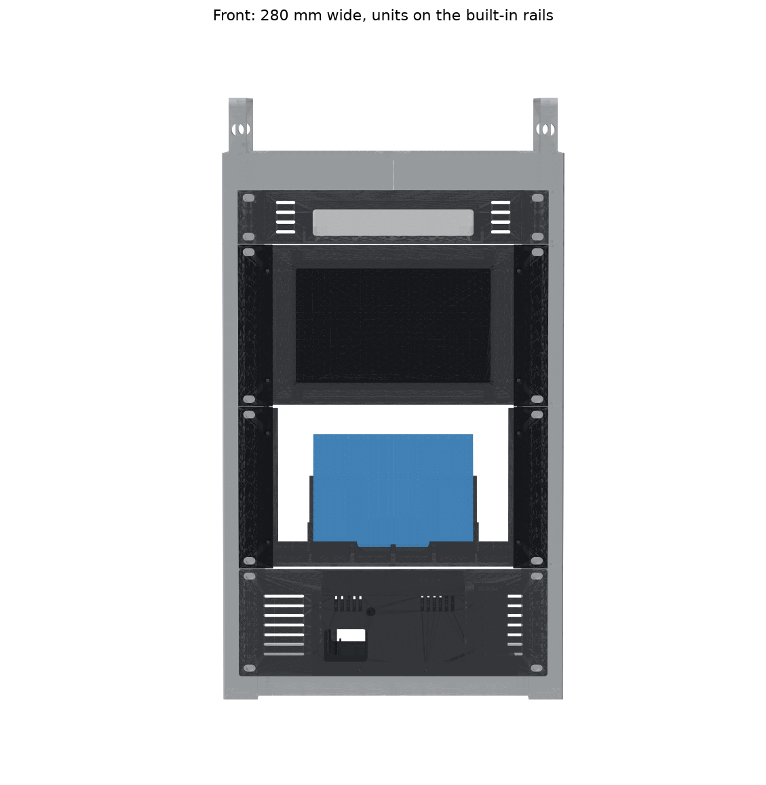
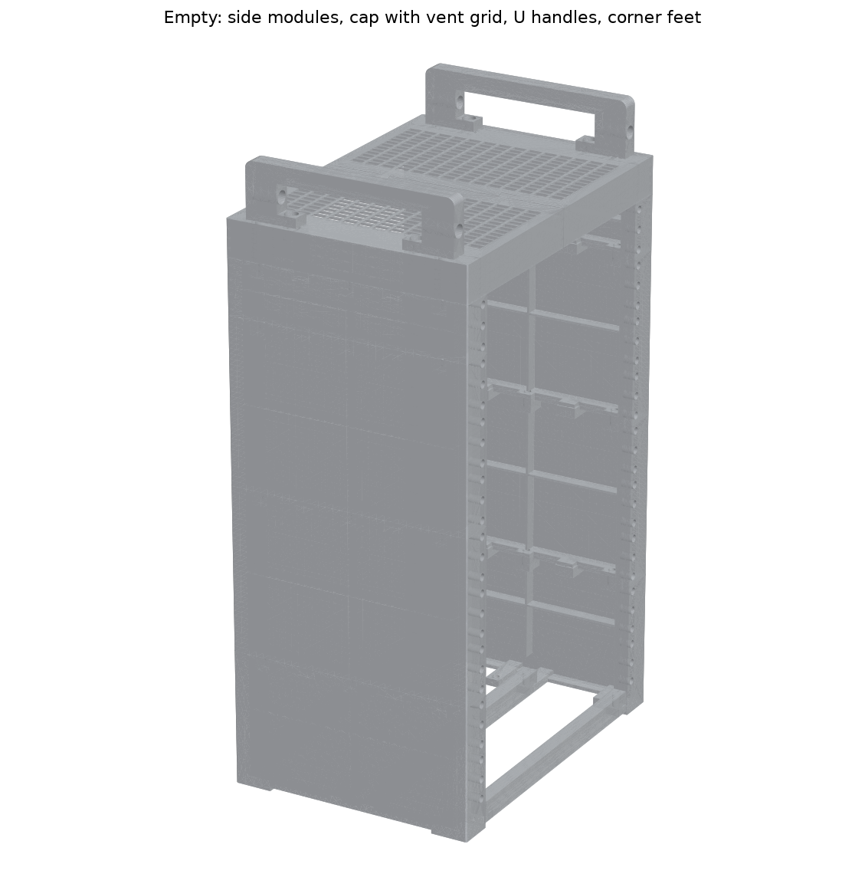
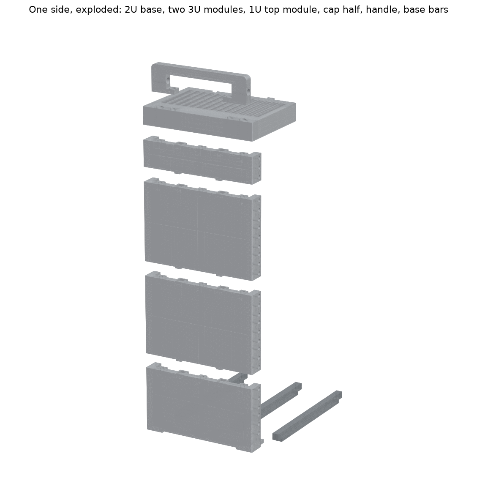

# Printable 10-inch 9U Mini Rack — RackMate T0 look (v7.2: v7.1 + a 1U gateway shelf)

This rack copies the **DeskPi RackMate T0** that Jeff Geerling used for **Mini Rack 001 and 002**:
- a 280 × 200 mm footprint
- solid silver side walls, with the rails built into the front and rear posts
- a top cap with a punched-style vent grid
- two U handles, front to back, with a round eye in each leg
- feet at the four corners

It's 9U tall, so it holds all four of your units. From bottom to top: the **Pi unit (2U)**, the **B1 face-out dock (3U)**, the **7" screen (3U)** and the **UniFi UCG-Ultra shelf (1U)**, which sits just under the cap.

**Size:** 280 W × 200 D mm. It's 450 mm tall to the top of the cap and 495 mm to the handle tops.
**Rails:** 10-inch standard: holes 236.525 mm apart, 224 mm clear between the posts, 27 EIA holes per post, at the front and the rear. A 10" PDU fits at the back as in Mini Rack 002.

## v7.2: one more U on top
Each side gets a **1U top module** (`Rack_SideModule_1U_Top_x2.stl`) on top of its two 3U modules, and the cap now sits on those. The 1U module is the same design as the others, just shorter: wall, posts with three rail holes front and rear, ribs, keys and joint bosses. Every other rack file is unchanged from v7.1. The UCG-Ultra shelf is in `../5_UCG-Ultra_1U/`.

## v7.1: same rack, about 100 g less filament, stiffer walls
| | v7.0 | v7.1 |
|---|---|---|
| Side walls | 1.6 mm, plain | **1.2 mm**, with a cross of 10 mm stiffening ribs inside each panel |
| Posts | 14 mm deep | 12 mm (still 3 mm round the rail inserts, 2 mm behind them) |
| Top and bottom ribs | 16 × 4 mm full length | 10 × 3 mm strip, with pads at the screws and keys |
| Cap | 2 mm top, 3 mm bands, solid corner columns | 1.6 mm top with a more open grid, 2 mm bands, hollow columns with solid screw bosses |
| Rack filament (PLA, same settings) | 1,029 g | **928 g** |
| Panel stiffness (20 N press in the middle) | ~4.3 mm | **~2.6 mm** |

The joints, screws, inserts, rails and outside dimensions haven't changed, and every unit fits as before.

## What v7 fixed from v6
| v6 problem | v7 |
|---|---|
| It tipped back with ~6 N on the B1 button. The check script used a pivot that doesn't touch the desk. | It stands on four corner feet 200 mm apart (front to back). It now takes **~17 N** at the B1 button and **~11 N** at the screen to tip it. |
| It was 129 mm deep, a slim tower. | 200 mm deep, like the T0. Commercial 10" gear fits too. |
| There was nowhere to stick the rubber feet. | Each corner has a 28 × 30 mm foot pad. |
| 28 printed parts, 68 heat-set inserts, countersunk screws. | 13 printed parts, 38 M5 inserts and **one screw size** (M5 × 12 button head). |
| The Pi shelf's rubber feet clashed with the base bars. | The shelf sits on two base bars, and its feet (optional) hang clear. |

## How it's built
- **Side modules:** each one is a single print: the wall, the front and rear posts with the rails, the edge ribs and the stiffening ribs. Each side stacks one 2U base and two 3U modules. The 3U middle and 3U top are the same part.
  - At each joint, three M5 screws go down through the upper module's bottom rib into inserts in the lower module's top rib.
  - Two keys drop into pockets so the walls line up flush.
- **Base:** the 2U base modules carry on 20 mm below the rack space down to the desk. They have the corner foot pads and ledges for three base bars.
  - The bars (front, middle and rear) tie the two sides together.
  - The Pi unit's shelf rests on the front and middle bars.
  - Each bar has two screws, fitted from below.
- **Cap:** two halves locked together at the centre by dovetails. It sits on the top modules, with two screws per side going down through the corner columns.
- **Handles:** each foot tab takes one screw into an insert in a cap column.
- **Left and right:** every part is front/rear symmetric. The left-hand part is the right-hand one turned 180°, so you print one STL per part type.

## Print list
PLA (silver or grey; the cap in black for the two-tone T0 look), **no supports**. The STLs are already laid out for a 220 mm bed. On your P1S, follow `../PRINT_PLAN_P1S.md`: plates 1–7 and 12, with the base bars laid straight.

| File (`STL_for_printing/`) | Qty | On the bed (mm) | Settings | ≈ g each (PLA) |
|---|---|---|---|---|
| `Rack_SideModule_2U_Base_x2.stl` | 2 | 200 × 109 × 40, outer face down | 3 walls, 15% gyroid, 0.24 mm | 93 |
| `Rack_SideModule_3U_x4.stl` | 4 | 200 × 136 × 28, outer face down | 3 walls, 15% gyroid, 0.24 mm | 104 |
| `Rack_SideModule_1U_Top_x2.stl` | 2 | 200 × 48 × 28, outer face down | 3 walls, 15% gyroid, 0.24 mm | 50 |
| `Rack_CapHalf_x2.stl` | 2 | 148 × 200 × 30, vent grid down | 3 walls, 15%, 0.24 mm | 96 |
| `Rack_Handle_x2.stl` | 2 | 172 × 45 × 14, on its side | 4 walls, 20%, 0.24 mm | 36 |
| `Rack_BaseBar_x3.stl` | 3 | 224 × 17 × 11 (diagonal in the file for 220 mm beds) | 3 walls, 15%, 0.24 mm | 21 |

**Rack total ≈ 1,030 g PLA** (928 g for the v7.1 parts plus 100 g for the two 1U modules). This is a slicer-like estimate from `source/estimate_filament.py`; your slicer gives exact numbers.

**Tips:**
- Use 3 wall loops. The P1S default is 2, but the extra loop matters around the heat-set inserts.
- Print one 3U module first and check that an M5 insert sets cleanly in a rail hole and a joint boss.
- With PLA in the P1S, prop the top lid open.

## Hardware (rack)
| Item | Qty | Where |
|---|---|---|
| M5 heat-set inserts, Ø6.4 hole, 8–10 mm long | 48 (a 90-piece kit covers it) | 18 joint bosses + 4 cap bosses (top ribs), 4 cap columns, 6 base-bar ends, 16 rail holes (Pi, dock, screen, UCG shelf) |
| M5 × 12 button-head screws | 48 (buy 55) | 18 module joints, 4 cap, 6 base bars, 4 handles, 16 unit ears |
| M5 washers | 16 (buy 20) | under the unit-ear screws |
| Stick-on rubber feet, 10–15 mm | 4 | under the corner foot pads |

A 3 mm hex L-key reaches every screw. The joint screws sit inside the modules, and the handle screws sit under the grip.

## Assembly
1. **Inserts:** press them into:
   - the top-rib bosses of every module: 3 each in the 2U bases and in **every** 3U, 2 each (front and rear) in the 1U tops
   - the cap columns (2 per half)
   - both ends of each base bar (from below)
   - the rail holes you need: 4 per unit
2. **Sides:** for each side, stack the 2U base, a 3U, a 3U and the 1U top. Let the keys drop into the pockets, then fit 3 screws per joint down through the upper module's bottom rib.
3. **Base:** lay the rack on its back. Set the three bars on the ledges (front, middle and rear) and screw each end from below through the ledge.
4. **Cap:** lower one cap half onto the other so the dovetails lock. Set the cap on the 1U top modules and fit 4 screws down through the corner columns.
5. **Handles:** 1 screw per foot tab, into the cap columns. These cover the cap screws.
6. **Feet:** stick the rubber feet under the four corner pads.
7. **Units:** rack them from the bottom up: Pi unit, B1 dock, screen, UCG shelf. Each takes 4 M5 × 12 screws with washers. Plug the gateway's cables in before racking its shelf: about 5 N on the gateway's back tips the rack forward.

## Check by hand
- **Cables:** the back is open. The Pi's ports are about 85 mm in from the rear rail plane.
- **Heat:** air comes in under the base (20 mm plinth) and through the open back, and it leaves through the vent grid in the cap.
- **Label:** like Jeff's racks, print a "001" label on the B1 and stick it on the cap's front band.

## Checks
`VERIFICATION_rack.txt` has **39 PASS, 0 FAIL**. It covers:
- no collisions, with the real Pi unit loaded from its STEP files, plus the dock, the Display7C screen and the UCG-Ultra shelf
- the gateway held in its tray, 11.6 mm of air over it under the cap's vent grid
- every screw line clear into its insert
- the keys engaging
- the EIA holes and the 10" standard
- wall thickness around the inserts
- bed fit
- tipping
- carrying by one handle
- side-panel stiffness
- loads on the cap and base bars

These are calculations on the 3D models and hand calcs, not a physical test.

## Source
`source/` holds the CadQuery scripts (`pip install cadquery trimesh scipy pillow matplotlib`):
- `rack_t0.py`: all the rack parts. The dimensions are at the top.
- `export_rack.py <Pi STEP folder> <out folder>`: writes the STLs, STEPs and images. The Pi STEP folder is `../4_Pi_Unit_2U/STEP_for_Onshape`.
- `verify_rack_t0.py <Pi STEP folder> <STL folder>`: re-runs the checks.
- `estimate_filament.py <STL folder>`: grams per part (PLA).
