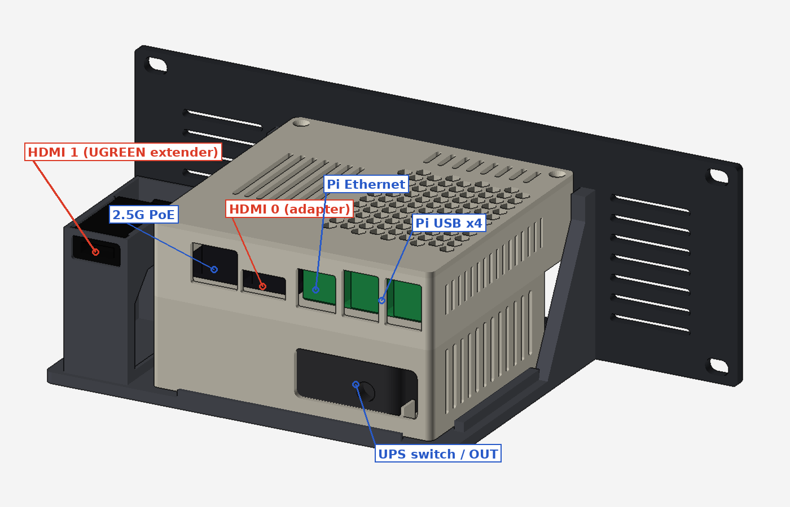

# Pi 5 Mini Server — 10-inch 2U Rack Unit (print-fixed, 27 Oct)

The unit holds:
- a Raspberry Pi 5 (8 GB)
- a Waveshare Pi5 Connector Adapter (F) with 2.5G PoE
- an EVM 512 GB 2230 NVMe SSD
- a GeeekPi Armor Lite V5 cooler
- a Cuzor Mini UPS Pro 12 V

They sit in the v3 stacked case, on a 10-inch 2U faceplate and shelf, at the bottom of the T0-look rack.

**Overall size:** 254 W × 121 D × 88.1 H mm (2U).

**Already printed this unit from the 25 Oct files?** Keep it. It fits the T0-look rack as it is. The fixes below only matter for parts you haven't printed yet.

## What changed from the 25 Oct files
| Old file | Problem | Fixed file |
|---|---|---|
| `Pi5_UPS_v3_ups_tray.stl` | Four 3 mm feet under the floor left the whole 10,400 mm² floor printing in mid-air ("floor down, no supports" fails). | `Pi5_UPS_v3_ups_tray_pinned.stl`: the feet are gone and there are four Ø4.4 locating holes in the floor. It prints flat. |
| `Rack_Shelf.stl` | It had sockets for those feet. | `Rack_Shelf_pinned.stl`: the sockets are now standoffs with a Ø4 pin each. The tray sits at **exactly the same height**, so ports, vents and the HDMI tower still line up. The 1.5 mm air gap under the tray is kept. |
| `Pi5_UPS_v3_lid.stl` | Saved top-up, standing on its teeth. | Saved top-face down. |
| `Rack_Faceplate_*.stl` | Saved standing on their edges. | Saved front-face down. |

The board tray and the shims haven't changed. `VERIFICATION_print.txt` checks every STL here.

## Ports
| Side | Ports (left to right, seen from that side) |
|---|---|
| **Rear** (cables) | HDMI 1 (UGREEN extender), 2.5G PoE, HDMI 0 (adapter), Pi Ethernet, Pi USB × 4. Below them: the UPS switch, LED and 12 V OUT. |
| **Front** (faceplate) | Pi power button (press with a ~25 mm pin), 12 V DC-IN to the UPS, vents |

## Print list
PETG, 0.2 mm layers, 3 walls, 20% infill, **no supports**. Every file is already laid out on the bed.

| File (`STL_for_printing/`) | Qty | On the bed (mm) | ≈ g |
|---|---|---|---|
| `Pi5_UPS_v3_ups_tray_pinned.stl` | 1 | 118 × 91 × 37, floor down | 62 |
| `Pi5_UPS_v3_board_tray_HDMIexit.stl` | 1 | 118 × 114 × 29, floor down | 65 |
| `Pi5_UPS_v3_lid.stl` | 1 | 118 × 114 × 6, top face down | 28 |
| `Pi5_UPS_v3_shims.stl` | 1 set | 37 × 27 × 2 (4 each of 0.5, 1 and 2 mm) | 1 |
| `Rack_Shelf_pinned.stl` | 1 | 170 × 117 × 68, base down (the HDMI port tower is part of it) | 96 |
| `Rack_Faceplate_Left.stl` + `Rack_Faceplate_Right.stl` | 1 + 1 | 127 × 88 × 4 each, front face down (220 mm bed) | 34 + 31 |
| *or* `Rack_Faceplate_2U_10in.stl` | 1 | 254 × 88 × 4, front face down (256 mm bed) | 65 |

The floor of the shelf's HDMI tower bridges 24 mm. That's normal for PETG.

## Hardware
| Item | Qty | Where |
|---|---|---|
| M3 × 12 countersunk | 3 | UPS tray to board tray (from inside the board tray) |
| M3 × 8 countersunk | 2 | lid (back edge) |
| M2.5 × 8 screws | 4 | Pi 5. They self-tap into 2.2 mm pilots; for heat-set inserts, drill the pilots to 3.6 mm. |
| M2.5 × 10 screws + printed shims | 4 | Waveshare adapter |
| M3 heat-set inserts (Ø4) | 6 | shelf posts (4) and shelf front lip (2) |
| M3 × 8 countersunk | 6 | faceplate to shelf |
| Rubber feet, Ø10 mm | 4, optional | under the shelf; in the rack they hang clear in the plinth |
| Double-sided foam tape | — | on the UPS ribs |
| Right-angle 5.5 × 2.1 mm DC plug lead | 1 | UPS OUT to the adapter's 7–24 V screw terminal |
| 12 V **≥ 3 A** power brick (5.5 × 2.1) | 1 | into the UPS DC-IN |
| **M5 × 12 button head + washers** | 4 | faceplate to the T0-look rack's rail inserts (counted in the rack's hardware) |

## Assembly
1. **UPS:** stick foam tape on the ribs of the UPS tray. Set the UPS in with its switch end on the right, and switch it ON.
2. **Trays:** place the board tray on the UPS tray and fit the 3 × M3 × 12 joint screws from inside.
3. **Pi:** screw the Pi 5 onto its four bosses, then fit the Armor Lite V5.
4. **Adapter:**
   - Plug it fully into the Pi.
   - Slide shims under each hole until each one just touches the board without lifting it.
   - Mark each spot through the hole, drill a 2.0 mm pilot and screw the adapter down.
5. **Inside connections:**
   - Fit the PCIe FFC and the NVMe SSD.
   - Run the 12 V lead from UPS OUT through the right channel, out the back window and up through the board-tray floor hole to the screw terminal.
   - **Check polarity.**
6. **HDMI extender:** plug the UGREEN micro-HDMI end into the Pi's free micro-HDMI port, and lead the cable out through the slot in the board tray's left wall.
7. **Lid:** hook the two front teeth in, lower the lid and fit the 2 × M3 × 8 back screws.
8. **Shelf:**
   - Press in the 6 heat-set inserts.
   - Snap the UGREEN HDMI end into the port tower from the top, socket facing the rear.
   - Set the case on the four standoffs so the pins drop into the tray's floor holes.
9. **Faceplate:** screw it onto the shelf with 6 × M3 × 8.
10. **Rack it:** at the bottom 2U of the rack, with 4 × M5 × 12 and washers. The shelf rests on the rack's front and middle base bars.
11. **Power:** plug the 12 V brick into the UPS through the faceplate's DC-IN window.

## Before you print or power up
- **Free micro-HDMI:** the adapter's edge sits ~1 mm from the Pi. Before printing, confirm that the UGREEN micro plug seats in the free port with the adapter fitted.
- **One power source only:** feed the adapter from the UPS (screw terminal) **or** from PoE, not both. With the UPS, plug the 2.5G port into a non-PoE switch port.
- **Current budget:** at full load the Pi draws ~2.5 A at 12 V, against the UPS's 3 A limit. Use a 12 V brick of at least 3 A.
- **HATs:** none fit under the v3 lid with the Armor Lite fitted. A 5–10 mm lid riser would fix this, and the rack leaves 14 mm of headroom.
- **UGREEN end size:** the holder assumes 23 × 12 × 38 mm. Measure yours; if it differs, edit `HF_W`, `HF_H` and `HF_L` in `source/pi_rack.py` and re-run `pi_unit_fix.py`.

## Checks
- **`VERIFICATION_print.txt`** (27 Oct): every STL is watertight, flat on the bed and fits the bed.
- **`../1_Rack_9U_T0-look/VERIFICATION_rack.txt`:** the fit in the rack.
  - no collisions
  - faceplate slots on the inserts
  - shelf on the base bars
  - tray on the standoffs at the old height
- **`docs/VERIFICATION_25Oct_ports_airflow.txt`** (25 Oct): ports, airflow, power and HDMI routing. Those parts haven't changed: 38 PASS, 1 FAIL (HATs, see above), 1 WARN (one power source), 2 UNVERIFIED (adapter layout).

## Files
- `STL_for_printing/`, `STEP_for_Onshape/`: the fixed parts. The STEPs are in the v3 assembly frame.
- `Component_Models/`: one-part STEP models of the Pi 5, adapter, UPS, cooler, SSD and UGREEN end, for Onshape.
- `source/pi_rack.py`: the shelf and faceplate script. `shelf()` has the standoffs and pins.
- `source/pi_unit_fix.py source/original_STEP_25Oct <out folder>`: rebuilds the pinned tray and the shelf, then writes every STL laid out for printing.
- `source/case_v3.py` (build123d): the v3 case.
- `source/verify_25Oct.py`: kept for reference; it needs the 25 Oct build environment.
- `docs/v3_case_original_README.md`: the v3 case notes.
