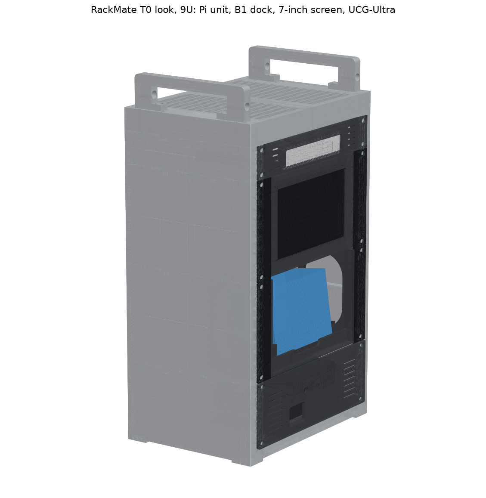

# Pi 5 Mini Rack v7.2 — all files (27 Oct 2026)

This is a printable 10-inch rack in the style of the **DeskPi RackMate T0** from Jeff Geerling's **Mini Rack 001 and 002**:
- 280 × 200 mm footprint
- solid silver sides with the rails built in
- a vented top cap and two U handles

**v7.2 is 9U tall.** It's the light v7.1 rack plus a 1U shelf on top for a **UniFi Cloud Gateway Ultra (UCG-Ultra)**. It stands 450 mm to the top of the cap and 495 mm to the handle tops.

From bottom to top:
1. **Pi 5 + UPS unit (2U):** `4_Pi_Unit_2U/` (PETG)
2. **NIIMBOT B1 face-out dock (3U):** `2_B1_Dock_3U/` (PLA)
3. **7" touch screen (3U):** `3_Display_7in_3U/` (PLA). This is the C-type module (Display7C) for the Waveshare 7" HDMI LCD (C) in your cart. Measure the four numbers in its README before printing.
4. **UCG-Ultra shelf (1U):** `5_UCG-Ultra_1U/` (PETG). The gateway's display shows through a window in the front, and its ports and power are at the open back.

The rack is in `1_Rack_9U_T0-look/`. This folder has everything; you don't need any older files.

## What changed from v7.1
- **Rack:** one more module per side, `Rack_SideModule_1U_Top_x2.stl` (print 2), on top of the 3U stack. Every other rack part is the same file as in v7.1.
- **New unit:** `5_UCG-Ultra_1U/UCG_Ultra_1U_Shelf.stl`. It's one piece with the ears built in, and it prints face down.
- **Hardware:** +10 M5 inserts, +10 M5 × 12 screws and +4 washers. Each 3U module now takes 3 joint inserts (the old top one took 2); each 1U top module takes 2 (for the cap).
- **12 V power:** a plug-in 12 V adapter replaces the Mean Well LRS-150-12. There's no mains wiring and no rear PSU panel.

## Start with these
- **`PRINT_PLAN_P1S.md`:** your P1S plan. It has the 12 plates, the settings for each, the print time and the costs.
- **`BOM_Pi5-MiniRack_v7.2.xlsx`:** everything to buy. Your 27 Oct order is marked as bought and your cart prices are filled in. The Printed_Parts tab has editable print costs.
- **Interactive 3D:** https://claude.ai/artifact/9pqgvvRfigWwcD8ecrPeBo. It shows the 9U v7.2 rack: assembled and exploded views, the 12 P1S plates and every part. Tap any part to see what it is. It's private to your claude.ai account.
- **`VISUALS/`:** still images, all v7.2. They include the 12 P1S plates, everything exploded, the parts sheet, the rack views, `ucg_front.png`, and `parts/` (one picture per STL).

## Print and cost at a glance (Bambu P1S)
- **Plates:** 12. Plates 1–9 are PLA (rack, B1 dock, screen); the two 1U top modules share plate 5. Plates 10–12 are PETG (Pi unit, UCG shelf).
- **Filament:** PLA ≈ 1.29 kg, so buy 2 spools. PETG ≈ 0.41 kg, so 1 spool.
- **Print time:** about 45 h, mostly unattended.
- **Cost doing it yourself:** **≈ ₹5,400** (filament ₹2,900, P1S running cost ₹500, build hardware ₹1,964).
- **Cost paying an experienced person:** **≈ ₹16,800** (adds 19 h × ₹600).

## Your order and cart (27 Oct)
- **Ordered (#3781408):**
  - Raspberry Pi 5 8GB
  - Waveshare Pi5 Connector Adapter (F), the exact one the Pi unit is designed for
  - 5 × WeAct 1.54" e-paper (not part of the rack yet)
  - Mean Well LRS-150-12: **cancel or return it** (see below)
- **12 V power: a plug-in adapter instead of the LRS-150-12.**
  - **What to get:** 12 V, 3 A or more (5 A preferred), 5.5 × 2.1 mm plug, centre positive. For example the Mean Well GST60A12-P1J (12 V 5 A).
  - **How it connects:** it plugs straight into the UPS DC-IN. You need only one right-angle DC lead, from UPS OUT to the adapter's screw terminal.
- **Cancelling the LRS-150-12:** the order only shows a whole-order "Cancel Order" button, which would also cancel the Pi 5 and the adapter. Ask the seller to cancel just that line, or return it when it arrives.
- **UCG-Ultra:** the ₹17,949 listing (B0D8PSW2BZ) and the ₹18,999 one are the same unit, so the BOM uses the cheaper one. It's wired only and has **no Wi-Fi**, whatever the listing says. It comes with its own 5 V USB-C adapter. A 0.5 m Cat6 patch cable connects it to the Pi's 2.5G port.
- **Never connect the 20 V USB-C trigger cable in your cart to the UPS.**
- **Still to spend** (BOM, cart prices): **≈ ₹47,000**, of which ₹17,949 is the UCG-Ultra.
  - The screen runs off a Pi USB port, so it needs no 5 V adapter.
  - The BOM notes list the cart items that aren't needed.

## Everything to print
| Folder | File | Qty | Material | ≈ g each |
|---|---|---|---|---|
| 1_Rack | Rack_SideModule_2U_Base_x2.stl | 2 | PLA | 93 |
| 1_Rack | Rack_SideModule_3U_x4.stl | 4 | PLA | 104 |
| 1_Rack | **Rack_SideModule_1U_Top_x2.stl** | 2 | PLA | 50 |
| 1_Rack | Rack_CapHalf_x2.stl | 2 | PLA | 96 |
| 1_Rack | Rack_Handle_x2.stl | 2 | PLA | 36 |
| 1_Rack | Rack_BaseBar_x3.stl | 3 | PLA | 21 |
| 2_B1_Dock | B1_Dock_3U_Body.stl | 1 | PLA | 125 |
| 2_B1_Dock | B1_Dock_3U_Ear_x2.stl | **4** (2 dock, 2 screen) | PLA | 10 |
| 2_B1_Dock | B1_Spacer_5mm_x2.stl, only if your B1 is ~62 mm thick | 2 | PLA | 9 |
| 3_Display | Display7C_3U_Body.stl + Display7C_Clip_x4.stl | 1 + 4 | PLA | 71 + 4 × 0.6 |
| 4_Pi_Unit | Pi5_UPS_v3_ups_tray_pinned, board_tray_HDMIexit, lid, Rack_Shelf_pinned, Rack_Faceplate_2U_10in (one piece on a P1S), shims | 1 each | PETG | 316 in total |
| 5_UCG-Ultra | **UCG_Ultra_1U_Shelf.stl** (ears included) | 1 | PETG | 95 |

## Everything to buy (hardware)
| Item | Qty |
|---|---|
| M5 heat-set inserts, Ø6.4 hole, 8–10 mm long | 48 (a 90-piece kit covers it) |
| M5 × 12 button-head screws | 48 (buy 55) |
| M5 washers | 16 (buy 20) |
| M3 heat-set inserts, Ø4 hole, ~6 mm long | 12, + 6 for the Pi shelf |
| M3 × 8 countersunk screws | 8, + 8 for the Pi unit |
| M3 × 8 button-head screws | 4 |
| Stick-on rubber feet, 10–15 mm | 4 |
| Pi unit extras: M3 × 12 countersunk ×3, M2.5 × 8 ×4, M2.5 × 10 ×4, 1 × right-angle 5.5×2.1 DC lead | see `4_Pi_Unit_2U/README.md` |
| 1 mm foam tape, felt (optional), small zip ties | — |

A 3 mm hex L-key does every rack screw. You need a soldering iron with insert tips for the heat-set inserts.

## Build order
1. **Rack:** inserts → stack each side (2U base, 3U, 3U, 1U top; 3 screws per joint) → three base bars (from below) → cap halves (dovetails) onto the 1U tops → handles → rubber feet.
2. **Pi unit:** see `4_Pi_Unit_2U/README.md`.
3. **B1 dock:** inserts → ears → spacers if your B1 is ~62 mm.
4. **Screen module:** inserts → screen face down on the bezel → foam on the corner tabs → 4 clips → ears. See its README; fold the flat HDMI cable straight back at the plug.
5. **UCG shelf:** drop the gateway in, display forward. **Plug its cables in now:** about 5 N on the gateway's back tips the rack forward, and an RJ45 plug can need 20 N. If you plug in later, steady the rack with your other hand.
6. **Units:** rack them from the bottom up (Pi unit, B1 dock, screen, UCG shelf), each with 4 M5 × 12 screws and washers.

## Checks
All the checks pass:
- **Rack:** 39, including collisions with the real Pi unit, the Display7C screen and the UCG shelf, every screw line, tipping, panel stiffness and loads.
- **UCG-Ultra shelf:** 15. They cover the fit and how the gateway is held, the ports staying clear, the rail slots, bed fit with no supports, and the tray's strength.
- **B1 dock:** 24, for both a 67 mm and a 62 mm B1.
- **Pi unit print checks:** 8 files.
- **Screen module:** 23 checks against Waveshare's own 3D model of the screen.

Tipping: it takes about 21 N at the B1 button, 13 N on the screen or 11 N pulling on a label, up from 17, 11 and 9 N in v7.1 because the gateway adds weight. These are calculations on the 3D models, not a physical test. **Measure your B1 before printing its dock.**

## Also in this folder
- **`Alternatives/NIIMBOT-B1-Drawer_10in-2U_2026-10-26.zip`:** a 2U pull-out drawer for the B1. With the Pi unit it makes a 4U rack exactly like Mini Rack 001/002.
