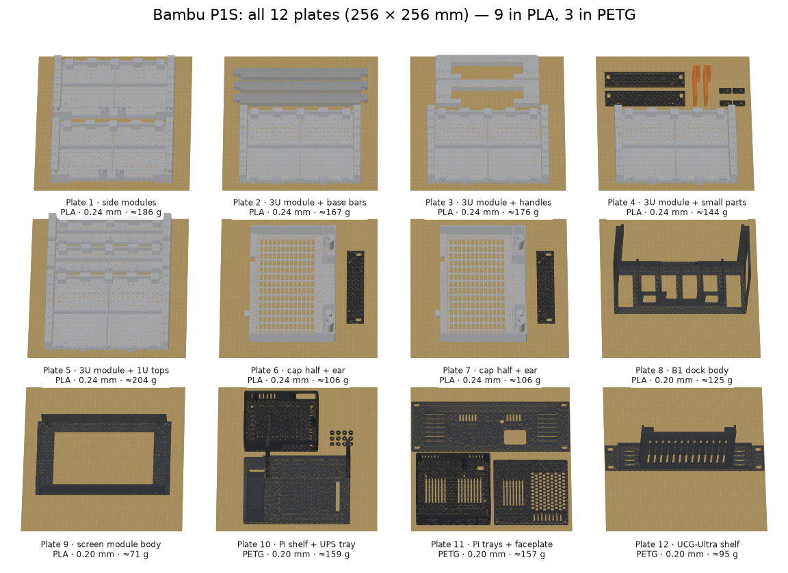

# Print plan — Bambu Lab P1S, v7.2 9U (27 Oct 2026)

This plan uses your P1S's 256 × 256 mm bed to fit all 20 STLs onto **12 plates**: 9 in PLA (rack, B1 dock, screen) and 3 in PETG (Pi unit, UCG-Ultra shelf). Every part also fits a 220 mm bed.

**Before you print:**
- **Screen module (plate 9 and the clips):** this is the C-type module (Display7C) for the Waveshare 7" HDMI LCD (C) in your cart. Measure the four numbers in `3_Display_7in_3U/README.md` first.
- **B1 dock (plate 8):** measure your B1. If it's about 62 mm thick, keep the two spacers on plate 4; if it's 67 mm, take them off.

## The plates
| Plate | Parts | Material · layer height | ≈ g |
|---|---|---|---|
| 1 | Side module 2U base ×2 | PLA · 0.24 mm | 186 |
| 2 | Side module 3U + base bars ×3 (straight, side by side) | PLA · 0.24 mm | 167 |
| 3 | Side module 3U + handles ×2 | PLA · 0.24 mm | 176 |
| 4 | Side module 3U + rack ears ×2 + B1 spacers ×2 (only for a 62 mm B1) + screen clips ×4 | PLA · 0.24 mm | 144 |
| 5 | Side module 3U + **side module 1U top ×2** (new in v7.2) | PLA · 0.24 mm | 204 |
| 6 | Cap half + rack ear | PLA · 0.24 mm | 106 |
| 7 | Cap half (the same file again) + rack ear | PLA · 0.24 mm | 106 |
| 8 | B1 dock body | PLA · 0.20 mm | 125 |
| 9 | Screen module body, C type (Display7C) | PLA · 0.20 mm | 71 |
| 10 | Pi shelf + UPS tray + adapter shims | PETG · 0.20 mm | 159 |
| 11 | Pi board tray + lid + **one-piece faceplate** (254 mm, fits the 256 mm bed) | PETG · 0.20 mm | 157 |
| 12 | **UCG-Ultra shelf** (new in v7.2): front face down, straight across the bed (254 × 44), 137 mm tall | PETG · 0.20 mm | 95 |

The four rack ears are spread over plates 4, 6 and 7: two for the dock and two for the screen.

**Totals:**
- **PLA:** ≈ 1.29 kg, or 1.48 kg with 15% spare. Buy **2 spools**.
- **PETG:** ≈ 0.41 kg for the Pi unit and the UCG shelf, or 0.47 kg with spare. Buy **1 spool**. If you already printed the Pi unit, about 0.1 kg is still needed for the shelf.
- **Print time:** about **45 hours**, mostly unattended: roughly 32 h for the PLA plates and 13 h for PETG. This is an estimate; Bambu Studio gives the real figure per plate.

In Bambu Studio, import the STLs from each folder, use a new plate for each row above, and press **A** (arrange) on each plate, or place the parts as shown in the picture. Turn the base bars and the UCG shelf straight; their STLs come turned 45° so they also fit a 220 mm bed.

## Settings
| | Rack parts (plates 1–7) | Dock, screen (8–9) | Pi unit, UCG shelf (10–12) |
|---|---|---|---|
| Profile | 0.24 mm Draft @BBL P1S | 0.20 mm Standard @BBL P1S | 0.20 mm Standard @BBL P1S |
| Filament | Generic PLA | Generic PLA | Generic PETG |
| Wall loops | **3** (default is 2) | 3 | 3 |
| Sparse infill | 15% gyroid (handles: 4 walls, 20%) | 15% gyroid | 20% gyroid (UCG shelf 15%) |
| Supports | none | none | none |
| Plate | Textured PEI | Textured PEI | Textured PEI (no glue) |
| Enclosure | **top lid or door open** (PLA heat-creeps in a closed P1S) | top open | **closed** |

**Why 0.24 mm for the rack:** the side modules and the cap print with their outside faces down on the PEI sheet, so the visible finish comes from the bed, not the layer height. The thicker layers save about 20% of the time on the biggest plates.

**UCG shelf:** it stands 137 mm tall on its 3 mm front face. Clean the plate, keep the enclosure closed and watch the first layers. Add a 5 mm brim if your plate is worn.

**Print order:** print plate 3 first and test a heat-set insert in its rail holes and joint bosses before printing the other three 3U modules. The M5 holes are Ø6.4 × 10 mm deep. If your inserts are made for another hole size, change `INS_D` in `1_Rack_9U_T0-look/source/rack_t0.py` and re-export before printing the rest.

## What v7.1 changed to save filament (rack only)
- **Side walls:** 1.2 mm instead of 1.6 mm. A cross of 10 mm ribs inside each panel makes them stiffer than before: a firm 20 N press moves a panel about 2.6 mm, against 4.3 mm in v7.0.
- **Posts and ribs:** posts are 12 mm deep (was 14). The top and bottom ribs are a 3 × 10 mm strip, with pads only at the screws and keys.
- **Cap:** 1.6 mm top with a more open vent grid (about 58% open), 2 mm bands, and hollow corner columns with solid bosses around the screws.

That made the 8U rack 0.93 kg of PLA instead of 1.03 kg. v7.2 adds the two 1U top modules (100 g), so the 9U rack is ≈ 1.03 kg. All 39 rack checks pass:
- collisions with every unit
- every screw line
- tipping: ~21 N at the B1 button. Plug the gateway's cables in **before** racking its shelf, because ~5 N on its back tips the rack forward.
- carrying by one handle
- loads on the cap and base bars

## Cost
| | Doing it yourself | Paying an experienced person |
|---|---|---|
| Filament: 2 × PLA at ₹900, 1 × PETG at ₹1,100 | ₹2,900 | ₹2,900 |
| P1S running cost (~45 h: electricity + nozzle and plate wear) | ₹500 | ₹500 |
| Build hardware (inserts, screws, washers, feet, tape) | ₹2,034 | ₹2,034 |
| Labour: 19 h × ₹600 | — | ₹11,400 |
| **Total** | **≈ ₹5,400** | **≈ ₹16,800** |

**Labour breakdown (19 h):**
- about 8 h for slicing, 12 plate changes, cleanup and a test print
- 2.5 h for ~66 heat-set inserts
- about 8.5 h for assembling the rack, dock, screen, Pi unit and UCG shelf, cabling and a power-up test

**Assumptions:**
- Generic PLA costs ₹800–1,000/kg. Bambu-brand PLA is much dearer in India (one listing was about ₹7,000 a spool).
- The ₹600/h rate is my estimate; I found no published Indian rates for this kind of work.
- Already printed the Pi unit? Take off about 2.5 h of print handling. You still need about 0.1 kg of PETG for the UCG shelf.
- All the inputs are editable in `BOM_Pi5-MiniRack_v7.2.xlsx` → Printed_Parts tab → "Cost to print it on your Bambu P1S".

## Tools
- Soldering iron with M5 and M3 heat-set insert tips (about ₹500–800 if you don't have one)
- 3 mm hex L-key
- Flush cutters and a deburring tool for cleanup
