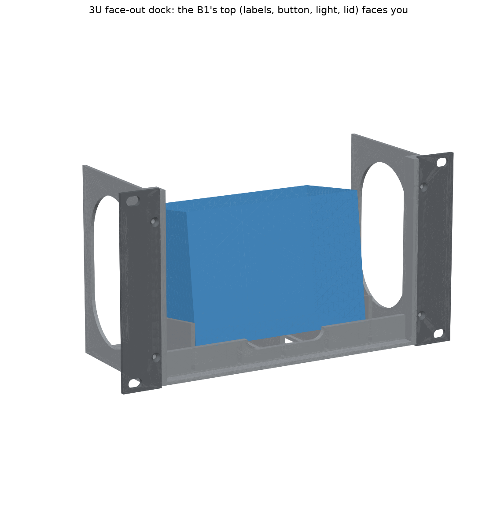
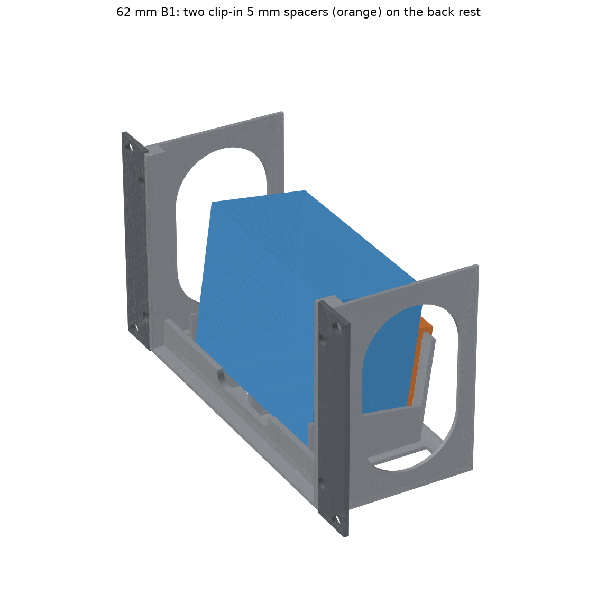

# NIIMBOT B1 Face-Out Dock — 10-inch 3U Rack Unit (v4)

The B1 stands on its long side with its **top facing out of the rack**. The label slot, power button, status light and lid all face you, so you can print labels without taking the printer out. It goes in the middle 3U of the T0-look rack.

## New in v4: fits a 62 mm or a 67 mm thick B1
Listings disagree on the B1's thickness. Walmart gives 5.2 × 3.6 × 2.4 in (≈ 132 × 91 × 61 mm), and Galaxus gives 67 mm. So the cradle is now sized for **67 mm**, and two clip-in **5 mm spacers** take up the difference on a 62 mm printer.
- **Measure yours.** If it's about 62 mm, print `B1_Spacer_5mm_x2.stl` twice.
- **Fitting the spacers:** hook each one over the top edge of the back rest, one on each side of the cable notch. Then set the printer in.
- **Either way** there's the same 1.5 mm gap behind the printer, and it leans back 8° against the rest.

Everything else is as in v3:
- **Print in place:** labels feed straight out the front.
- **Lid:** opens outward. Nothing frames the printer's face.
- **Lip:** 2.5 mm, holding the printer's bottom edge.
- **Finger room:** 24 mm each side for the open-slide button.
- **Removal while racked:** tip the printer forward, lift it 3.5 mm and slide it out.
- **Cable:** the rear notch takes the USB-C cable to the Pi.

**Size:** 254 × 132.55 mm panel (3U), 95 mm deep.

## Print list
PETG, 0.2 mm layers, 3 walls, 15% infill, **no supports**.

| File (`STL_for_printing/`) | Qty | On the bed (mm) | ≈ g each |
|---|---|---|---|
| `B1_Dock_3U_Body.stl` | 1 | 214 × 95 footprint, 130 tall, floor down | 128 |
| `B1_Dock_3U_Ear_x2.stl` | **4** (2 for the dock, 2 for the screen module) | 28 × 133 × 3, flat; turn one 180° | 10 |
| `B1_Spacer_5mm_x2.stl` | 2, **only for a 62 mm B1** | 11 × 59 profile, 34 tall, on its side | 10 |

The dock body is 214 mm wide, so it needs a full 220 mm bed. Turn the skirt off or keep it close.

## Hardware
| Item | Qty |
|---|---|
| M3 heat-set inserts (Ø4 hole, 6 deep), in the front posts | 4 |
| M3 × 8 countersunk, ears to body | 4 |
| M5 × 12 button head + washers (or M5 thumbscrews for tool-less removal) | 4 |
| Self-adhesive felt sheet (optional) | 1 |

## Assembly
1. Melt in the 4 inserts.
2. Screw on the ears.
3. If your B1 is about 62 mm thick, hook the two spacers over the back rest.
4. Rack the dock.
5. Set the B1 in with its top facing out and its bottom edge behind the lip, then let it lean back.
6. Run the USB-C cable out the back to a Pi USB port.

## Check by hand
- **Lid hinge:** check that the lid clears the 2.5 mm lip when it opens. If it doesn't, file the lip down.
- **Open-slide button:** if it ends up facing down, stand the B1 on its other long side. The dock is symmetric.

`VERIFICATION_dock.txt` has **24 PASS, 0 FAIL**. It checks both a 67 mm printer and a 62 mm printer with the spacers. `source/` regenerates every file: run `export_dock.py <out folder>` and `verify_dock.py`.
