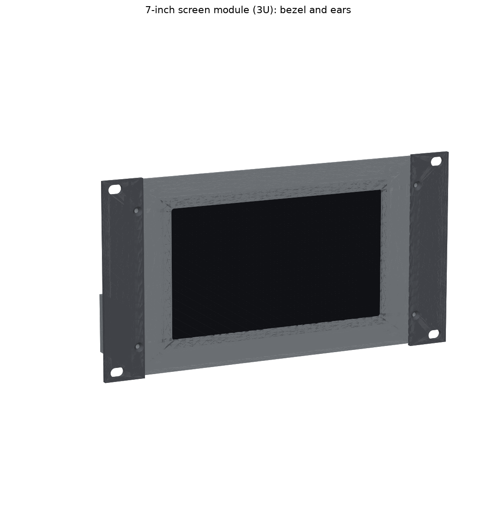
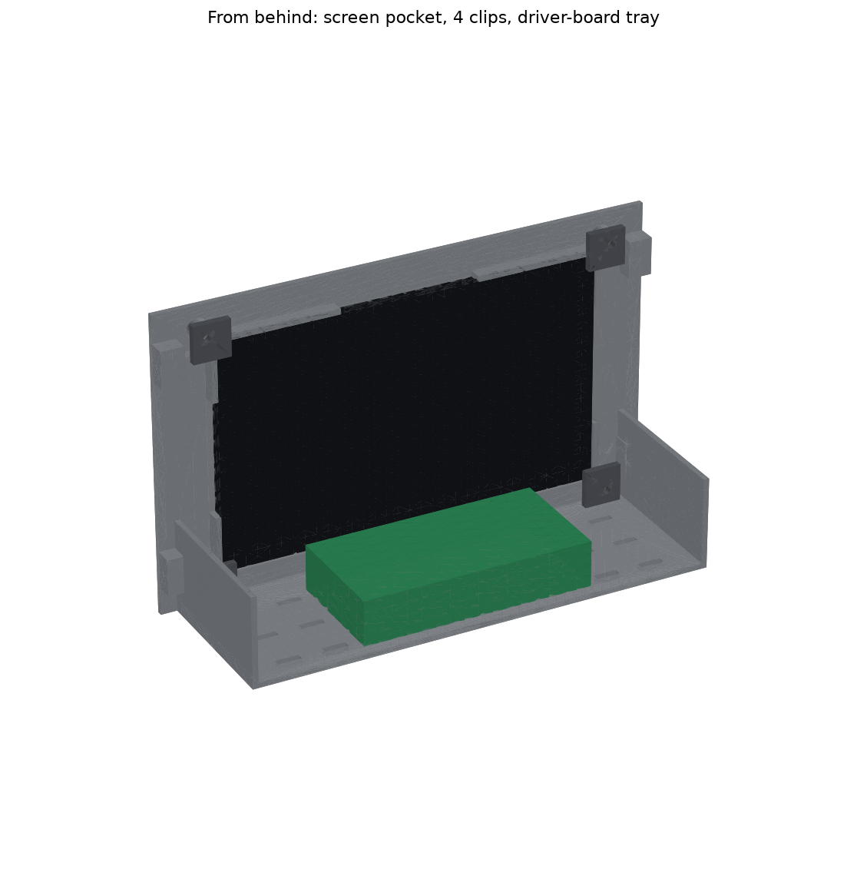

# 7-inch Touch Screen Module — 10-inch 3U

This module holds the **REES52 7" HDMI touch screen** (1024 × 600, capacitive USB touch) in the top 3U of the T0-look rack. It's unchanged from 26 Oct; only the files were regenerated for this bundle.

## Screen data used
These figures come from REES52's listing. **Measure your screen before printing.**
- **Glass:** 165 × 100 × 5 mm. The pocket allows 0.3 mm clearance all round.
- **Active area:** 154.08 × 85.92 mm. The bezel window is 156 × 88 mm.
- **Power:** 5 V at 1–2 A, 6–7 W.
- **Connections:** HDMI for the picture, USB for touch.

The listing doesn't give the driver board's size or where its connectors are, so the board sits on a slotted tray and is held with zip ties or foam tape. The pocket wall around the glass has gaps on all four edges, so the ribbon cables can leave from any side.

## How it works
- **Glass:** it drops into a pocket behind a 2.4 mm bezel. **Four corner clips** with 1 mm foam tape under them hold it in, each with one M3 screw.
- **Driver board and touch controller:** they sit on the tray behind the screen, which is 186 × 67 mm with zip-tie slots on a 20 mm grid.
- **Ears:** they are the **same part as the B1 dock's ears**, so print two more of `B1_Dock_3U_Ear_x2.stl` (in `2_B1_Dock_3U/`).

## Print
PETG or PLA, 3 walls, 15% infill, no supports.

| File | Qty | On the bed | ≈ g |
|---|---|---|---|
| `Display7_3U_Body.stl` | 1 | 214 × 130 × 70 mm, bezel face down | 101 |
| `Display7_Clip_x4.stl` | 4 | 16 × 16 × 3 mm | 1 |
| `B1_Dock_3U_Ear_x2.stl` (from `2_B1_Dock_3U/`) | 2 | flat | 10 |

## Hardware
| Item | Qty |
|---|---|
| M3 heat-set inserts (Ø4 hole, 6 deep) | 8 (4 ears + 4 clips) |
| M3 × 8 countersunk | 4 (ears) |
| M3 × 8 button head | 4 (clips) |
| Thin foam tape, 1 mm | for the clips and under the driver board |
| M5 × 12 + washers (rack screws) | 4 |

## Wiring
- **Picture:** a short HDMI cable (30–50 cm) from the Pi unit's rear HDMI port to the driver board. Check whether the board has a full-size or mini HDMI socket before you buy the cable.
- **Touch:** a USB cable from the touch controller to a Pi USB port at the rear.
- **Power:** use a separate 5 V 2 A USB adapter for the screen. Don't run it from the Pi's USB ports or the UPS. The UPS's 3 A is already mostly used by the Pi at full load, and the screen needs up to 2 A at 5 V.

All 13 checks pass, in `VERIFICATION_display.txt`. `source/` regenerates the files: run `export_display.py <out folder>` and `verify_display.py`.
