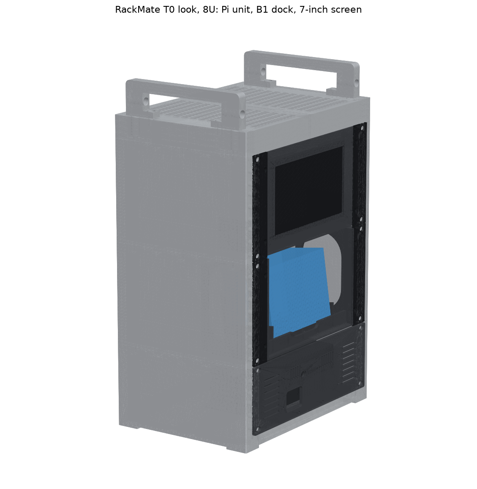
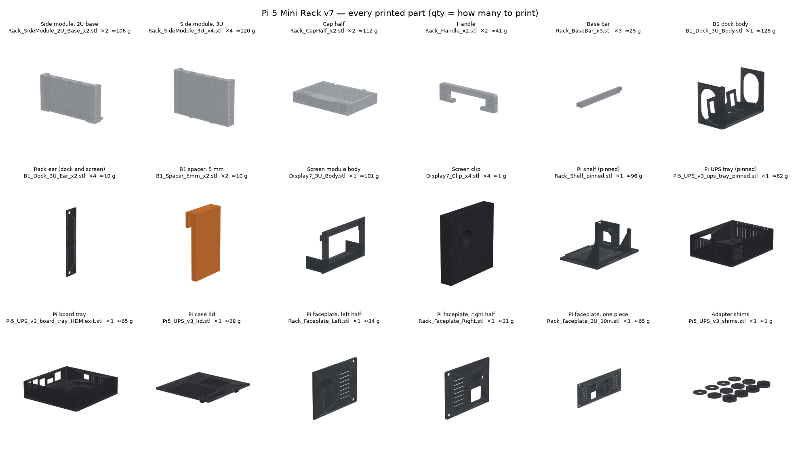

# Pi 5 Mini Rack v7 — all files (revised, 27 Oct 2026)

This is a printable 10-inch rack in the style of the **DeskPi RackMate T0** from Jeff Geerling's **Mini Rack 001 and 002**:
- 280 × 200 mm footprint
- solid silver sides with the rails built in
- a vented top cap and two U handles

It's 8U tall (like the RackMate T1), so it holds all your units. From bottom to top:
1. **Pi 5 + UPS unit (2U):** `4_Pi_Unit_2U/`
2. **NIIMBOT B1 face-out dock (3U):** `2_B1_Dock_3U/`
3. **7" REES52 touch screen (3U):** `3_Display_7in_3U/`

The rack is in `1_Rack_8U_T0-look/`. Each folder has a README, print-ready STLs (already laid out on the bed), STEP files for Onshape, images, a check report and the CadQuery source.

**This one zip has everything.** You no longer need the 25 Oct Pi unit zip or the 26 Oct v6 files.

## See it
- **Interactive 3D:** https://claude.ai/artifact/9pqgvvRfigWwcD8ecrPeBo. Turn it around, explode it, see every print plate, and tap any part. It's private to your claude.ai account.
- **`VISUALS/`:** still images.
  - `everything_exploded.png`
  - `print_plates.png` (every print as it sits on a 220 mm bed)
  - `all_parts_sheet.png` (all 18 printed parts, labelled with qty and grams)
  - `pi_unit_exploded.png`
  - the rack, dock and screen views
  - `parts/` (one picture per STL)

## What v7 fixed (from v6, 26 Oct)
| Problem | Fix |
|---|---|
| **Tipping:** about 6 N on the B1 button tipped it (the check used a pivot that isn't on the desk). | Four corner feet, 200 mm apart front to back: **~18 N** at the B1 button, **~11 N** at the screen. |
| **Pi unit STLs** weren't laid out for printing, and the UPS tray's floor printed in mid-air. | Every file is laid flat. The tray's feet became shelf standoffs with pins, at the same height. |
| **Pi shelf rubber feet** clashed with the base. | The shelf rests on two base bars, and its feet (optional) hang clear. |
| **B1 thickness:** listings say 62 or 67 mm. | The dock fits 67 mm; two clip-in 5 mm spacers fit a 62 mm B1. |

## Everything to print
PETG (silver or grey; print the cap in black if you want the two-tone T0 look), 0.2 mm layers, **no supports**. Every part fits a 220 mm bed. The dock and screen bodies are 214 mm wide, so leave the skirt off.

| Folder | File | Qty | ≈ g each |
|---|---|---|---|
| 1_Rack | Rack_SideModule_2U_Base_x2.stl | 2 | 106 |
| 1_Rack | Rack_SideModule_3U_x4.stl | 4 | 120 |
| 1_Rack | Rack_CapHalf_x2.stl | 2 | 112 |
| 1_Rack | Rack_Handle_x2.stl | 2 | 41 |
| 1_Rack | Rack_BaseBar_x3.stl | 3 | 25 |
| 2_B1_Dock | B1_Dock_3U_Body.stl | 1 | 128 |
| 2_B1_Dock | B1_Dock_3U_Ear_x2.stl | **4** (2 dock, 2 screen) | 10 |
| 2_B1_Dock | B1_Spacer_5mm_x2.stl, only if your B1 is ~62 mm thick | 2 | 10 |
| 3_Display | Display7_3U_Body.stl | 1 | 101 |
| 3_Display | Display7_Clip_x4.stl | 4 | 1 |
| 4_Pi_Unit | Pi5_UPS_v3_ups_tray_pinned.stl | 1 | 62 |
| 4_Pi_Unit | Pi5_UPS_v3_board_tray_HDMIexit.stl | 1 | 65 |
| 4_Pi_Unit | Pi5_UPS_v3_lid.stl | 1 | 28 |
| 4_Pi_Unit | Rack_Shelf_pinned.stl | 1 | 96 |
| 4_Pi_Unit | Rack_Faceplate_Left.stl + _Right.stl (or the one-piece on a 256 mm bed) | 1 + 1 | 34 + 31 |
| 4_Pi_Unit | Pi5_UPS_v3_shims.stl | 1 set | 1 |

**Filament:** about 1.37 kg for the rack, dock and screen, or 1.68 kg with the Pi unit. Buy **two 1 kg spools**. If you already printed the Pi unit from the 25 Oct files, it fits as it is, so skip its rows.
**Print time:** roughly 45–60 hours on a fast modern printer, and about twice that on an older Ender-class one.

## Everything to buy (hardware)
| Item | Qty |
|---|---|
| M5 heat-set inserts, Ø6.4 hole, 8–10 mm long | 38 (buy 50; a 90-piece kit covers it) |
| M5 × 12 button-head screws | 38 (buy 45) |
| M5 washers | 12 (buy 16) |
| M3 heat-set inserts, Ø4 hole, ~6 mm long | 12, + 6 for the Pi shelf |
| M3 × 8 countersunk screws | 8, + 8 for the Pi unit |
| M3 × 8 button-head screws | 4 |
| Stick-on rubber feet, 10–15 mm | 4 |
| Pi unit extras: M3 × 12 countersunk ×3, M2.5 × 8 ×4, M2.5 × 10 ×4, DC pigtail, 12 V ≥ 3 A brick | see `4_Pi_Unit_2U/README.md` |
| 1 mm foam tape, felt (optional), small zip ties | — |
| For the screen: a short HDMI cable (check full vs mini), a USB cable to the Pi, and a 5 V 2 A USB adapter | 1 each |

A 3 mm hex L-key does every rack screw.

## Full BOM with prices
**`BOM_Pi5-MiniRack_v7.xlsx`** is your 26 Oct BOM with the v7 parts and fastener counts. The electronics, prices and "Have it?" column are unchanged. The total is about ₹52,800, of which ₹44,700 is the Pi-side electronics.

## Build order
1. **Rack:** inserts → stack each side (2U base, 3U, 3U; 3 screws per joint) → three base bars (from below) → cap halves (dovetails) onto the top → handles → rubber feet.
2. **Pi unit:** see `4_Pi_Unit_2U/README.md`.
3. **Screen module:** inserts → glass with foam → 4 clips → driver board on the tray → ears.
4. **B1 dock:** inserts → ears → spacers if your B1 is ~62 mm.
5. **Units:** rack them from the bottom up (Pi unit, B1 dock, screen), each with 4 M5 × 12 screws and washers.

## Checks
All the checks pass:
- **Rack:** 34, including collisions with the real Pi unit, every screw line, tipping and loads.
- **B1 dock:** 24, for both a 67 mm and a 62 mm B1.
- **Screen module:** 13.
- **Pi unit print checks:** 8 files.

These are calculations on the 3D models, not a physical test. **Measure your B1 and the screen glass before printing their modules.**

## Also in this zip
- **`Alternatives/NIIMBOT-B1-Drawer_10in-2U_2026-10-26.zip`:** a 2U pull-out drawer for the B1. With the Pi unit it fills a 4U rack exactly like Mini Rack 001/002, if you ever want the short version.
