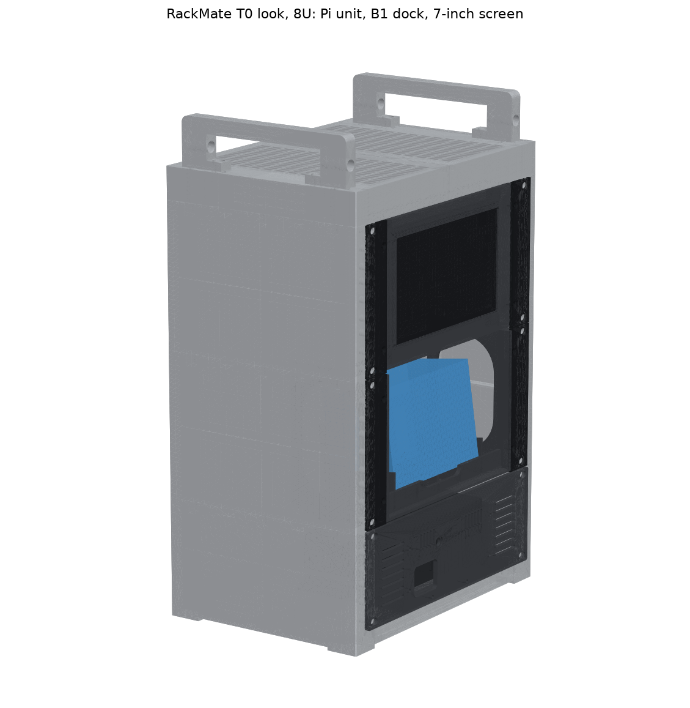
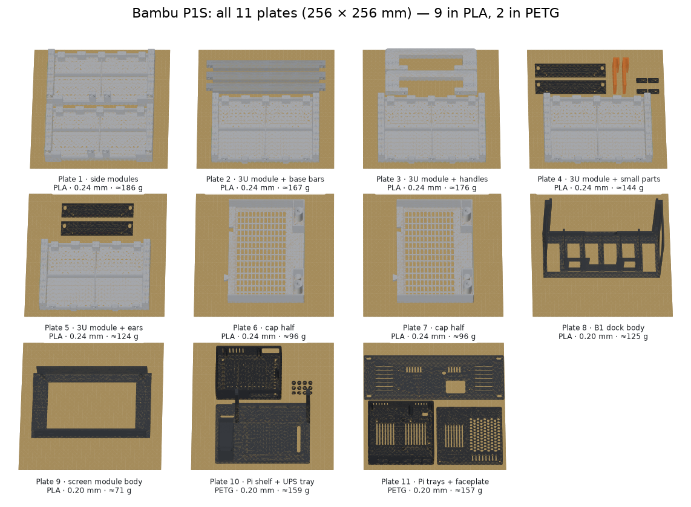

# Pi 5 Mini Rack v7.1 — all files (27 Oct 2026)

This is a printable 10-inch rack in the style of the **DeskPi RackMate T0** from Jeff Geerling's **Mini Rack 001 and 002**:
- 280 × 200 mm footprint
- solid silver sides with the rails built in
- a vented top cap and two U handles

It's 8U tall (like the RackMate T1). **v7.1 is the lighter version:** the rack takes about 100 g less PLA than v7.0, and its side panels are stiffer.

From bottom to top:
1. **Pi 5 + UPS unit (2U):** `4_Pi_Unit_2U/` (PETG)
2. **NIIMBOT B1 face-out dock (3U):** `2_B1_Dock_3U/` (PLA)
3. **7" touch screen (3U):** `3_Display_7in_3U/` (PLA). This is the C-type module (Display7C) for the Waveshare 7" HDMI LCD (C) in your cart. Measure the four numbers in its README before printing.

The rack is in `1_Rack_8U_T0-look/`. This zip has everything; you don't need the 25 Oct or 26 Oct files.

## Start with these
- **`PRINT_PLAN_P1S.md`:** your P1S plan. It has the 11 plates, the settings for each, the print time and the costs.
- **Interactive 3D:** https://claude.ai/artifact/9pqgvvRfigWwcD8ecrPeBo. Assembled and exploded views, the 11 P1S plates, and every part; tap any part to see what it is. It's private to your claude.ai account.
- **`BOM_Pi5-MiniRack_v7.1.xlsx`:** everything to buy, with your 27 Oct order marked as bought and your cart prices filled in. The Printed_Parts tab has editable print costs.
- **`VISUALS/`:** still images.
  - `print_plates_P1S.png`
  - `everything_exploded.png`
  - `all_parts_sheet.png`
  - `pi_unit_exploded.png`
  - the rack, dock and screen views (`display7c_*`)
  - `parts/` (one picture per STL)

## Print and cost at a glance (Bambu P1S)
- **Plates:** 11. Plates 1–9 are PLA (rack, B1 dock, screen); plates 10–11 are PETG (Pi unit).
- **Filament:** PLA ≈ 1.19 kg, so buy 2 spools. PETG ≈ 0.32 kg, so 1 spool, or none if the Pi unit is already printed.
- **Print time:** about 40 h, mostly unattended.
- **Cost doing it yourself:** **≈ ₹5,300** (filament ₹2,900, P1S running cost ₹500, build hardware ₹1,914).
- **Cost paying an experienced person:** **≈ ₹16,100** (adds 18 h × ₹600).

## Your order and cart (27 Oct)
- **Ordered (#3781408):**
  - Raspberry Pi 5 8GB
  - Waveshare Pi5 Connector Adapter (F), the exact one the Pi unit is designed for
  - Mean Well LRS-150-12
  - 5 × WeAct 1.54" e-paper (not part of the rack yet)
- **The Mean Well needs mains parts:**
  - a fused, switched IEC inlet with a T2A 5×20 fuse
  - earth to the PSU, and a terminal cover
  - an inline 5 A blade fuse on the 12 V run to the UPS
  - **Set its 115/230 V switch to 230 V before powering it.**
- **Never connect the 20 V USB-C trigger cable in your cart to the UPS.**
- **Still to spend** (BOM, cart prices): **≈ ₹26,500**.
  - The BOM now includes a 32 GB microSD card for the first boot and a 1 m micro-USB cable for the screen.
  - The screen runs off a Pi USB port, so it needs no 5 V adapter.
  - The BOM notes list the cart items that aren't needed.

## Everything to print
| Folder | File | Qty | Material | ≈ g each |
|---|---|---|---|---|
| 1_Rack | Rack_SideModule_2U_Base_x2.stl | 2 | PLA | 93 |
| 1_Rack | Rack_SideModule_3U_x4.stl | 4 | PLA | 104 |
| 1_Rack | Rack_CapHalf_x2.stl | 2 | PLA | 96 |
| 1_Rack | Rack_Handle_x2.stl | 2 | PLA | 36 |
| 1_Rack | Rack_BaseBar_x3.stl | 3 | PLA | 21 |
| 2_B1_Dock | B1_Dock_3U_Body.stl | 1 | PLA | 125 |
| 2_B1_Dock | B1_Dock_3U_Ear_x2.stl | **4** (2 dock, 2 screen) | PLA | 10 |
| 2_B1_Dock | B1_Spacer_5mm_x2.stl, only if your B1 is ~62 mm thick | 2 | PLA | 9 |
| 3_Display | Display7C_3U_Body.stl + Display7C_Clip_x4.stl | 1 + 4 | PLA | 71 + 4 × 0.6 |
| 4_Pi_Unit | Pi5_UPS_v3_ups_tray_pinned, board_tray_HDMIexit, lid, Rack_Shelf_pinned, Rack_Faceplate_2U_10in (one piece on a P1S), shims | 1 each | PETG | 316 in total |

## Everything to buy (hardware)
| Item | Qty |
|---|---|
| M5 heat-set inserts, Ø6.4 hole, 8–10 mm long | 38 (buy 50; a 90-piece kit covers it) |
| M5 × 12 button-head screws | 38 (buy 45) |
| M5 washers | 12 (buy 16) |
| M3 heat-set inserts, Ø4 hole, ~6 mm long | 12, + 6 for the Pi shelf |
| M3 × 8 countersunk screws | 8, + 8 for the Pi unit |
| M3 × 8 button-head screws | 4 |
| Stick-on rubber feet, 10–15 mm | 4 |
| Pi unit extras: M3 × 12 countersunk ×3, M2.5 × 8 ×4, M2.5 × 10 ×4, 2 × right-angle 5.5×2.1 DC leads | see `4_Pi_Unit_2U/README.md` |
| 1 mm foam tape, felt (optional), small zip ties | — |

A 3 mm hex L-key does every rack screw. You need a soldering iron with insert tips for the heat-set inserts.

## Build order
1. **Rack:** inserts → stack each side (2U base, 3U, 3U; 3 screws per joint) → three base bars (from below) → cap halves (dovetails) onto the top → handles → rubber feet.
2. **Pi unit:** see `4_Pi_Unit_2U/README.md`.
3. **B1 dock:** inserts → ears → spacers if your B1 is ~62 mm.
4. **Screen module:** inserts → screen face down on the bezel → foam on the corner tabs → 4 clips → ears. See its README; fold the flat HDMI cable straight back at the plug.
5. **Units:** rack them from the bottom up (Pi unit, B1 dock, screen), each with 4 M5 × 12 screws and washers.

## Checks
All the checks pass:
- **Rack:** 35, including collisions with the real Pi unit, every screw line, tipping, panel stiffness and loads.
- **B1 dock:** 24, for both a 67 mm and a 62 mm B1.
- **Pi unit print checks:** 8 files.
- **Screen module:** 23 checks against Waveshare's own 3D model of the screen, plus the full rack check with it in place.

These are calculations on the 3D models, not a physical test. **Measure your B1 before printing its dock.**

## Also in this zip
- **`Alternatives/NIIMBOT-B1-Drawer_10in-2U_2026-10-26.zip`:** a 2U pull-out drawer for the B1. With the Pi unit it makes a 4U rack exactly like Mini Rack 001/002.
